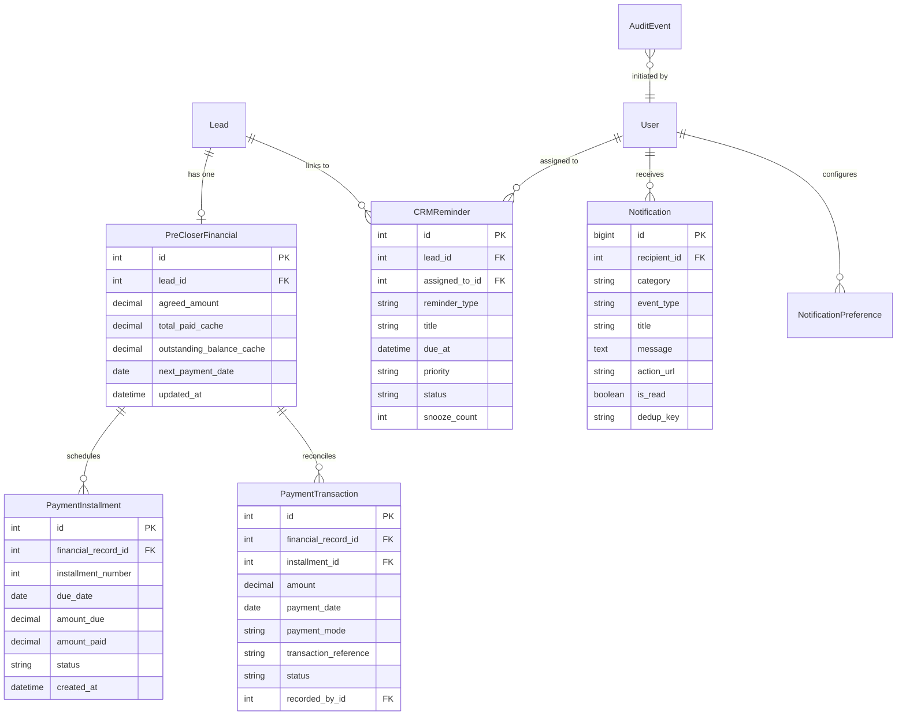
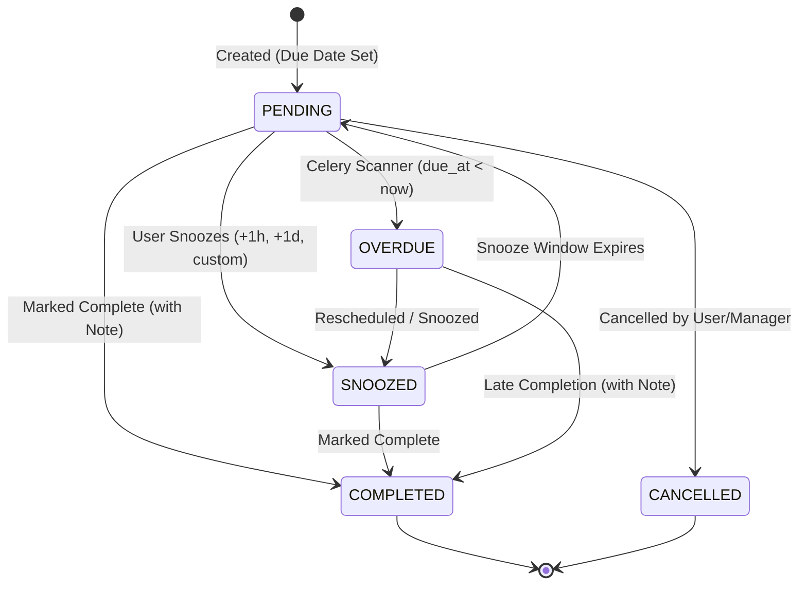
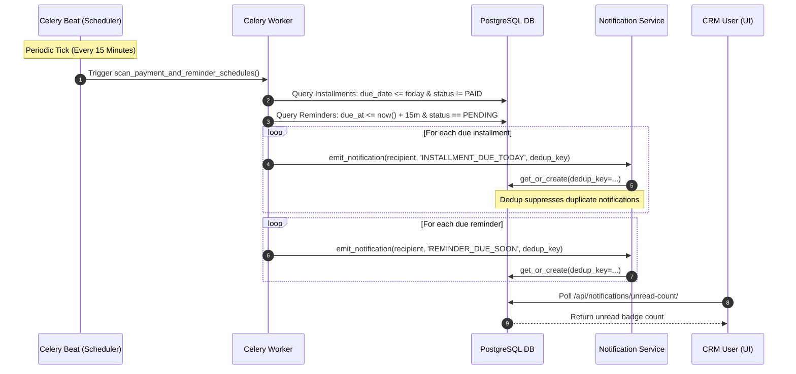

# Skill Move Sales CRM — Notifications, Reminders, Payment Scheduling & Centralized Activity Log Architecture Design

**Document ID:** `SM-ARCH-2026-NRPAL`  
**Classification:** Architectural Blueprint & Implementation Specification  
**Status:** Discovery & Planning (Implementation-Ready)  
**Author:** Principal Software Architect, DRF / React Specialist, Database & Security Engineer  
**Date:** October 11, 2026  
**Target Repository:** `Skill Move Sales CRM` (Django REST Framework + React/TypeScript)

---

## 1. Executive Summary

This architecture specification outlines the design for four interconnected, mission-critical operational capabilities within the **Skill Move Sales CRM**:

1. **Next Payment Date & Installment Scheduling (Requirement A)**: Transitioning from manual cumulative financial entries (`amount_paid`) to a double-entry reconciliation engine featuring individual verified `PaymentTransaction` records, structured `PaymentInstallment` schedules, dynamic `next_payment_date` resolution, and automated installment status lifecycle tracking.
2. **Centralized In-App Notifications Service (Requirement B)**: An event-driven, role-scoped notification pipeline with an authoritative `Notification` model, unread badge counter, idempotent dispatch engine, user category preferences, and global header bell dropdown with drill-downs to Lead 360 and task records.
3. **Dedicated Reminders & Task Follow-Up Module (Requirement C)**: Elevating the single `Lead.next_follow_up` timestamp into a complete `CRMReminder` / task engine supporting call reminders, meeting reminders, follow-ups, and payment collection alerts with snooze cycles, due-soon/overdue states, and strict separation between task completion and transactional proof.
4. **Centralized Activity & Security Audit Log (Requirement D)**: Expanding the existing `AuditEvent` infrastructure into an enterprise-grade, tamper-resistant audit warehouse accessible exclusively by authenticated Admins (organization-wide) and Managers (team-scoped), with correlation tracking, structured before/after diffs, and query indexing.

### Core Architectural Principles & Strict Guarantees
- **Total Preservation**: Existing ORM models (`Lead`, `PreCloserFinancial`, `LeadFinancialHistory`, `AuditEvent`, `CommunicationLog`), authentication schemas (`User`, `UserRole`), and database tables are 100% preserved.
- **Mathematical Invariant**:
  $$\text{Total Paid} = \sum(\text{Valid Payment Transactions})$$
  $$\text{Outstanding Balance} = \text{Total Agreed Amount} - \text{Total Paid}$$
  *Scheduled installments represent expected future commitments and are never counted as received funds.*
- **Honest Audit Trails**: Completing a reminder does not fabricate a phone call log or payment record. Communicating with a lead does not automatically mark reminders complete.
- **No Telephony / Mock Gateways**: External telephony (Callyzer auto-dialer) and mock payment gateways remain strictly uninitialized per project governance.

---

## 2. Existing Repository Inspection & Architecture Inventory

A comprehensive pre-design inspection of the repository was conducted across backend models, serializers, views, background workers, and frontend components.

```
┌─────────────────────────────────────────────────────────────────────────────────┐
│                           EXISTING BACKEND ARCHITECTURE                         │
├─────────────────────┬───────────────────────────┬───────────────────────────────┤
│ Django App          │ Primary Models            │ Primary Endpoints             │
├─────────────────────┼───────────────────────────┼───────────────────────────────┤
│ apps.authentication │ User (ADMIN/MANAGER/SALES)│ /api/auth/*                   │
│ apps.teams          │ Team                      │ /api/teams/*                  │
│ apps.leads          │ Lead, PipelineStage,      │ /api/leads/*                  │
│                     │ PreCloserFinancial,       │ /api/leads/<id>/financial/    │
│                     │ LeadFinancialHistory,     │ /api/leads/<id>/timeline/     │
│                     │ LeadStageHistory,         │ /api/leads/<id>/change-stage/ │
│                     │ LeadAssignmentHistory     │ /api/leads/dashboard-stats/   │
│ apps.communications │ CommunicationTemplate,    │ /api/communications/templates │
│                     │ CommunicationLog          │ /api/communications/logs/     │
│ apps.reports        │ ReportSchedule            │ /api/reports/schedules/       │
│ apps.audit          │ AuditEvent                │ /api/audit/events/            │
└─────────────────────┴───────────────────────────┴───────────────────────────────┘
```

### Verified File Paths & Existing Components

| Subsystem | File Path | Existing Implementation Details | Evidence Label |
|---|---|---|---|
| **Financial Models** | [`backend/apps/leads/models.py:L325-L415`](file:///d:/projects/CRM/backend/apps/leads/models.py#L325-L415) | `PreCloserFinancial` stores cumulative `agreed_amount` and `amount_paid`. `@property outstanding_balance` calculates `agreed_amount - amount_paid`. `LeadFinancialHistory` records snapshot history. | Verified |
| **Financial API** | [`backend/apps/leads/views.py:L363-L453`](file:///d:/projects/CRM/backend/apps/leads/views.py#L363-L453) | `LeadFinancialView` exposes `GET` and `PUT` on `/api/leads/<pk>/financial/`. Atomic transactions update cumulative values and create `AuditEvent(event_type='LEAD_FINANCIAL_RECORDED')`. | Verified |
| **Follow-Up State** | [`backend/apps/leads/models.py:L132`](file:///d:/projects/CRM/backend/apps/leads/models.py#L132) | Single nullable `next_follow_up = models.DateTimeField(null=True, blank=True)` on `Lead`. | Verified |
| **Audit Log Model** | [`backend/apps/audit/models.py:L4-L50`](file:///d:/projects/CRM/backend/apps/audit/models.py#L4-L50) | `AuditEvent` model with `event_type` (25 text choices), `user`, `details` (JSONField), and `timestamp`. | Verified |
| **Audit API** | [`backend/apps/audit/views.py:L7-L25`](file:///d:/projects/CRM/backend/apps/audit/views.py#L7-L25) | `AuditEventListView` on `/api/audit/events/` scoped via `IsAdminOrManagerRole`. Managers filtered by `user__team_id`. | Verified |
| **Timeline View** | [`backend/apps/leads/views.py:L458-L670`](file:///d:/projects/CRM/backend/apps/leads/views.py#L458-L670) | `LeadTimelineView` on `/api/leads/<id>/timeline/` aggregates lead creation, stage transitions, assignment history, communication logs, financial updates, and `AuditEvent` records into a chronological array. | Verified |
| **Celery Tasks** | [`backend/apps/reports/tasks.py:L9-L69`](file:///d:/projects/CRM/backend/apps/reports/tasks.py#L9-L69) | `execute_scheduled_reports` is the only Celery `@shared_task`. | Verified |
| **Celery Config** | [`backend/crm_project/settings.py:L159-L166`](file:///d:/projects/CRM/backend/crm_project/settings.py#L159-L166) | Redis broker & result backend configured (`redis://localhost:6379/0`). Celery beat daemon exists in `docker-compose.yml`, but **no periodic schedule is defined** in `settings.py`. | Verified |
| **Frontend Navigation** | [`frontend/src/components/Sidebar.tsx:L145-L295`](file:///d:/projects/CRM/frontend/src/components/Sidebar.tsx#L145-L295) | Navigation contains Dashboard, Unassigned, Import, Users, Teams, Templates, Profile. **No navigation items for Notifications, Reminders, or Activity Log.** | Verified |
| **Lead 360 Workspace** | [`frontend/src/components/Lead360Page.tsx`](file:///d:/projects/CRM/frontend/src/components/Lead360Page.tsx) | Full-page workspace with 7 tabs: Overview, Lead Information, Activity Timeline, Communications, Follow-Ups, Stage & Assignment History, Financials. | Verified |
| **Dashboard Radars** | [`frontend/src/components/RoleDashboard.tsx:L1480-L1710`](file:///d:/projects/CRM/frontend/src/components/RoleDashboard.tsx#L1480-L1710) | Section 5 (Follow-up queue) and Section 6 (Operational radar) track follow-up cadences and pending balances via client filtering. | Verified |

---

## 3. Reusable Capabilities & Verified Architectural Gaps

```
┌─────────────────────────────────────────────────────────────────────────────────┐
│                         GAP AUDIT & REUSABILITY MATRIX                          │
├──────────────────────────┬─────────────────────────────┬────────────────────────┤
│ Domain                   │ Existing Capabilities       │ Critical Gaps          │
├──────────────────────────┼─────────────────────────────┼────────────────────────┤
│ Payment Scheduling       │ PreCloserFinancial (totals) │ • No transaction model │
│                          │ LeadFinancialHistory        │ • No installment table │
│                          │ Decimal-safe PUT endpoint   │ • No next_payment_date │
│                          │ Atomic locking in DRF       │ • No due/overdue alert │
├──────────────────────────┼─────────────────────────────┼────────────────────────┤
│ In-App Notifications     │ None                        │ • Zero models/APIs     │
│                          │                             │ • No bell icon or UI   │
│                          │                             │ • No unread badge      │
├──────────────────────────┼─────────────────────────────┼────────────────────────┤
│ Reminders & Tasks        │ Lead.next_follow_up (single)│ • No title/description │
│                          │ Dashboard queue display     │ • No reminder types    │
│                          │                             │ • No snooze history    │
│                          │                             │ • No task assignment   │
├──────────────────────────┼─────────────────────────────┼────────────────────────┤
│ Centralized Audit Log    │ AuditEvent model (audit app)│ • No frontend UI       │
│                          │ Backend IsAdminOrManager    │ • Unstructured JSON    │
│                          │ /api/audit/events/ endpoint │ • No correlation ID    │
│                          │                             │ • Missing pagination   │
└──────────────────────────┴─────────────────────────────┴────────────────────────┘
```

### Verified Gaps Breakdown

1. **Payment Scheduling Gaps**:
   - `PreCloserFinancial` currently relies on users manually overriding `amount_paid` via `PUT /api/leads/<id>/financial/`.
   - There are no individual payment transactions recorded with payment date, mode (Bank Transfer, UPI, Cheque, Cash), transaction IDs, or receipt vouchers.
   - Installment dates and future payment plans do not exist; counsellors must record payment promises in free-text notes.
   - No `next_payment_date` index exists, forcing full-table scans to identify upcoming collections.

2. **In-App Notification Gaps**:
   - The CRM has zero notification models, endpoints, or UI indicators.
   - Users must manually refresh dashboards or spreadsheet views to discover lead assignments, stage changes, or overdue items.
   - Failed email dispatches (`CommunicationStatus.FAILED`) remain buried inside communication logs without alerting managers.

3. **Reminder & Task Gaps**:
   - `Lead.next_follow_up` stores only a solitary timestamp. It cannot differentiate between a phone call, a parent meeting, a fee collection reminder, or an internal review task.
   - Rescheduling a follow-up overwrites the existing timestamp with zero audit history of prior commitments or snooze counts.
   - Non-lead operational tasks (e.g. "Prepare admissions report", "Review batch schedule") cannot be created.

4. **Centralized Activity Log Gaps**:
   - Although `apps.audit.models.AuditEvent` exists, it is completely absent from the frontend UI.
   - `AuditEvent` stores target references inside an unindexed `details` JSON field, making query filtering by entity type (`lead`, `user`, `team`) inefficient.
   - `AuditEventListView` lacks standardized search, date range filtering, cursor pagination, and CSV export capabilities.

---

## 4. Proposed Data Model & Relationships

To preserve existing tables and avoid regression while fulfilling all requirements, we propose the introduction of **four targeted models** across two logical modules:
1. `apps.leads` receives payment scheduling and transaction tables.
2. `apps.audit` receives the centralized notification and task reminder models.



### Detailed Schema Specifications

#### 1. `PaymentInstallment` Model (`apps.leads.models`)
```python
class InstallmentStatus(models.TextChoices):
    SCHEDULED = 'SCHEDULED', 'Scheduled'
    PARTIALLY_PAID = 'PARTIALLY_PAID', 'Partially Paid'
    PAID = 'PAID', 'Paid in Full'
    OVERDUE = 'OVERDUE', 'Overdue'
    CANCELLED = 'CANCELLED', 'Cancelled'

class PaymentInstallment(models.Model):
    financial_record = models.ForeignKey(
        'leads.PreCloserFinancial',
        on_delete=models.CASCADE,
        related_name='installments'
    )
    installment_number = models.PositiveSmallIntegerField()
    due_date = models.DateField(db_index=True)
    amount_due = models.DecimalField(max_digits=12, decimal_places=2)
    amount_paid = models.DecimalField(max_digits=12, decimal_places=2, default=Decimal('0.00'))
    status = models.CharField(
        max_length=20,
        choices=InstallmentStatus.choices,
        default=InstallmentStatus.SCHEDULED,
        db_index=True
    )
    notes = models.TextField(blank=True, default='')
    created_by = models.ForeignKey(settings.AUTH_USER_MODEL, on_delete=models.PROTECT, related_name='+')
    updated_by = models.ForeignKey(settings.AUTH_USER_MODEL, on_delete=models.PROTECT, related_name='+')
    created_at = models.DateTimeField(auto_now_add=True)
    updated_at = models.DateTimeField(auto_now=True)

    class Meta:
        ordering = ['due_date', 'installment_number']
        unique_together = [('financial_record', 'installment_number')]
        indexes = [
            models.Index(fields=['status', 'due_date']),
        ]

    @property
    def remaining_due(self):
        return max(Decimal('0.00'), self.amount_due - self.amount_paid)
```

#### 2. `PaymentTransaction` Model (`apps.leads.models`)
```python
class PaymentMode(models.TextChoices):
    BANK_TRANSFER = 'BANK_TRANSFER', 'Bank Transfer (NEFT/RTGS/IMPS)'
    UPI = 'UPI', 'UPI / QR Code'
    CHEQUE = 'CHEQUE', 'Cheque / Demand Draft'
    CASH = 'CASH', 'Cash Receipt'
    PAYMENT_GATEWAY_MANUAL = 'ONLINE', 'Online Gateway (Manual Entry)'

class PaymentTransactionStatus(models.TextChoices):
    VERIFIED = 'VERIFIED', 'Verified / Cleared'
    BOUNCED = 'BOUNCED', 'Bounced / Rejected'
    REFUNDED = 'REFUNDED', 'Refunded'

class PaymentTransaction(models.Model):
    financial_record = models.ForeignKey(
        'leads.PreCloserFinancial',
        on_delete=models.CASCADE,
        related_name='transactions'
    )
    installment = models.ForeignKey(
        PaymentInstallment,
        on_delete=models.SET_NULL,
        null=True,
        blank=True,
        related_name='transactions'
    )
    amount = models.DecimalField(max_digits=12, decimal_places=2)
    payment_date = models.DateField(db_index=True)
    payment_mode = models.CharField(max_length=30, choices=PaymentMode.choices)
    transaction_reference = models.CharField(max_length=100, blank=True, default='')
    status = models.CharField(
        max_length=20,
        choices=PaymentTransactionStatus.choices,
        default=PaymentTransactionStatus.VERIFIED,
        db_index=True
    )
    notes = models.TextField(blank=True, default='')
    recorded_by = models.ForeignKey(settings.AUTH_USER_MODEL, on_delete=models.PROTECT, related_name='+')
    created_at = models.DateTimeField(auto_now_add=True)
    updated_at = models.DateTimeField(auto_now=True)

    class Meta:
        ordering = ['-payment_date', '-created_at']
        indexes = [
            models.Index(fields=['financial_record', 'status']),
        ]
```

#### 3. `Notification` & `NotificationPreference` Models (`apps.audit.models` or new `apps.notifications`)
```python
class NotificationCategory(models.TextChoices):
    LEAD = 'LEAD', 'Lead Lifecycle'
    STAGE = 'STAGE', 'Pipeline Stage'
    PAYMENT = 'PAYMENT', 'Payment & Financials'
    REMINDER = 'REMINDER', 'Reminders & Follow-Ups'
    COMMUNICATION = 'COMMUNICATION', 'Communications'
    TEAM = 'TEAM', 'Team & Staff Administration'
    SECURITY = 'SECURITY', 'Security & Access'
    SYSTEM = 'SYSTEM', 'System Operations'

class Notification(models.Model):
    recipient = models.ForeignKey(
        settings.AUTH_USER_MODEL,
        on_delete=models.CASCADE,
        related_name='notifications',
        db_index=True
    )
    actor = models.ForeignKey(
        settings.AUTH_USER_MODEL,
        on_delete=models.SET_NULL,
        null=True,
        blank=True,
        related_name='triggered_notifications'
    )
    category = models.CharField(max_length=30, choices=NotificationCategory.choices, db_index=True)
    event_type = models.CharField(max_length=60, db_index=True)
    title = models.CharField(max_length=200)
    message = models.TextField()
    target_entity_type = models.CharField(max_length=50, blank=True, default='')
    target_entity_id = models.CharField(max_length=50, blank=True, default='')
    action_url = models.CharField(max_length=255, blank=True, default='')
    is_read = models.BooleanField(default=False, db_index=True)
    read_at = models.DateTimeField(null=True, blank=True)
    priority = models.CharField(
        max_length=15,
        choices=[('LOW', 'Low'), ('NORMAL', 'Normal'), ('HIGH', 'High'), ('URGENT', 'Urgent')],
        default='NORMAL'
    )
    dedup_key = models.CharField(max_length=128, db_index=True, blank=True, default='')
    created_at = models.DateTimeField(auto_now_add=True, db_index=True)

    class Meta:
        ordering = ['-created_at']
        indexes = [
            models.Index(fields=['recipient', 'is_read', '-created_at']),
            models.Index(fields=['dedup_key', 'created_at']),
        ]
```

#### 4. `CRMReminder` Model (`apps.leads.models` or `apps.audit.models`)
```python
class ReminderType(models.TextChoices):
    CALL = 'CALL', 'Outbound Call Reminder'
    FOLLOW_UP = 'FOLLOW_UP', 'General Follow-Up'
    PAYMENT_COLLECTION = 'PAYMENT_COLLECTION', 'Fee Collection'
    MEETING = 'MEETING', 'Counseling Session / Meeting'
    TASK = 'TASK', 'Operational Task'
    CUSTOM = 'CUSTOM', 'Custom Reminder'

class ReminderStatus(models.TextChoices):
    PENDING = 'PENDING', 'Pending'
    COMPLETED = 'COMPLETED', 'Completed'
    SNOOZED = 'SNOOZED', 'Snoozed'
    CANCELLED = 'CANCELLED', 'Cancelled'

class CRMReminder(models.Model):
    lead = models.ForeignKey(
        'leads.Lead',
        on_delete=models.CASCADE,
        null=True,
        blank=True,
        related_name='reminders'
    )
    assigned_to = models.ForeignKey(
        settings.AUTH_USER_MODEL,
        on_delete=models.CASCADE,
        related_name='assigned_reminders',
        db_index=True
    )
    created_by = models.ForeignKey(
        settings.AUTH_USER_MODEL,
        on_delete=models.PROTECT,
        related_name='created_reminders'
    )
    reminder_type = models.CharField(max_length=30, choices=ReminderType.choices, default=ReminderType.FOLLOW_UP)
    title = models.CharField(max_length=200)
    description = models.TextField(blank=True, default='')
    due_at = models.DateTimeField(db_index=True)
    priority = models.CharField(
        max_length=15,
        choices=[('LOW', 'Low'), ('NORMAL', 'Normal'), ('HIGH', 'High'), ('URGENT', 'Urgent')],
        default='NORMAL'
    )
    status = models.CharField(
        max_length=20,
        choices=ReminderStatus.choices,
        default=ReminderStatus.PENDING,
        db_index=True
    )
    snooze_count = models.PositiveSmallIntegerField(default=0)
    snoozed_until = models.DateTimeField(null=True, blank=True)
    completed_at = models.DateTimeField(null=True, blank=True)
    completed_by = models.ForeignKey(
        settings.AUTH_USER_MODEL,
        on_delete=models.SET_NULL,
        null=True,
        blank=True,
        related_name='completed_reminders'
    )
    completion_note = models.TextField(blank=True, default='')
    created_at = models.DateTimeField(auto_now_add=True)
    updated_at = models.DateTimeField(auto_now=True)

    class Meta:
        ordering = ['due_at']
        indexes = [
            models.Index(fields=['assigned_to', 'status', 'due_at']),
        ]
```

---

## 5. Payment Scheduling Business Rules

```
┌─────────────────────────────────────────────────────────────────────────────────┐
│                           PAYMENT RECONCILIATION FLOW                           │
│                                                                                 │
│   [ Total Agreed Amount: ₹75,000 ]                                              │
│         │                                                                       │
│         ├── Installment #1: ₹25,000 Due Oct 15 ──> Recorded Tx #1: ₹25,000      │
│         │                                          (Installment -> PAID)        │
│         ├── Installment #2: ₹25,000 Due Nov 15 ──> Expected Future Obligation   │
│         │                                          (NEVER counted as paid)      │
│         └── Installment #3: ₹25,000 Due Dec 15 ──> Expected Future Obligation   │
│                                                                                 │
│   Reconciliation Formula:                                                       │
│   • Total Paid        = SUM(Verified Transactions)       = ₹25,000              │
│   • Outstanding       = Agreed (₹75,000) - Paid (₹25,000) = ₹50,000             │
│   • Next Payment Date = MIN(Due Date of Pending Installments) = Nov 15, 2026     │
└─────────────────────────────────────────────────────────────────────────────────┘
```

### Core Financial Invariants & Constraints

1. **Transaction Authority**:
   $$\text{PreCloserFinancial.amount\_paid} \equiv \sum_{t \in \text{Transactions}, \text{status}=\text{VERIFIED}} t.\text{amount}$$
   $$\text{PreCloserFinancial.outstanding\_balance} \equiv \text{agreed\_amount} - \text{amount\_paid}$$
   Manual editing of `amount_paid` is permanently deprecated in favor of recording verifiable `PaymentTransaction` records.

2. **Strict Installment Isolation**:
   Scheduled installments are purely operational forecasts. Under no circumstances may an unpaid installment balance be credited toward `amount_paid`.

3. **Installment Sum vs. Agreed Amount**:
   $$\sum_{i \in \text{Installments}} i.\text{amount\_due} \le \text{agreed\_amount}$$
   - Any scheduled plan whose installments sum to less than `agreed_amount` indicates an open uncommitted balance.
   - Any scheduled plan whose installments exceed `agreed_amount` is rejected by model validation (`ValidationError`).

4. **Dynamic Next Payment Date**:
   $$\text{next\_payment\_date} = \min(\{i.\text{due\_date} \mid i \in \text{Installments}, i.\text{status} \in \{\text{SCHEDULED}, \text{PARTIALLY\_PAID}, \text{OVERDUE}\}\})$$
   - If all installments are `PAID` or `CANCELLED`, `next_payment_date` evaluates to `None`.
   - Denormalized onto `PreCloserFinancial.next_payment_date` inside a database transaction to empower indexed sorting in spreadsheets and dashboard queries without N+1 queries.

5. **Partial Payment Allocation Strategy**:
   When a payment transaction is recorded:
   - If linked to an explicit installment, credit that installment's `amount_paid`. If `amount_paid == amount_due`, transition status to `PAID`. If `amount_paid < amount_due`, transition to `PARTIALLY_PAID`.
   - If unlinked (lump-sum payment), apply a waterfall algorithm to oldest pending installments first (`FIFO`), allocating partial credits sequentially.

6. **Overpayment Protection**:
   If a transaction amount exceeds the current `outstanding_balance`, the transaction is blocked with:
   `"Transaction amount (₹X) exceeds outstanding balance (₹Y). Overpayment is disallowed."`

7. **Contract Modification (Agreed Amount Changes)**:
   If an administrator updates `agreed_amount`:
   - If new `agreed_amount < total_paid`: Blocked (`ValidationError: Cannot reduce agreed amount below already verified payments`).
   - If new `agreed_amount > total_paid`: Remaining unscheduled amount is surfaced in the Lead 360 financial tab with a prompt: *"Unallocated commitment balance of ₹Z detected. Please schedule remaining installment."*

---

## 6. In-App Notification Event Catalogue & Recipient Matrix

Notifications are dispatched server-side within database transaction commit hooks (`transaction.on_commit`) to prevent notifying users of rolled-back operations.

```
┌─────────────────────────────────────────────────────────────────────────────────┐
│                        NOTIFICATION RECIPIENT MATRIX                            │
├─────────────────────────┬───────────────┬─────────────────┬─────────────────────┤
│ Event Trigger           │ Admin Scope   │ Manager Scope   │ Counsellor Scope    │
├─────────────────────────┼───────────────┼─────────────────┼─────────────────────┤
│ Lead Created / Import   │ Org Summary   │ Team Leads Only │ Assigned Lead Only  │
│ Lead Reassigned         │ Audit Digest  │ Old/New Team Mgr│ Assigned Counsellor │
│ Stage Change (PC/Enr)   │ Org Highlight │ Team Leads Only │ Assigned Counsellor │
│ Payment Recorded        │ Yes           │ Team Leads Only │ Assigned Counsellor │
│ Installment Overdue     │ Escalation    │ Team Leads Only │ Assigned Counsellor │
│ Reminder Due / Overdue  │ No            │ Overdue Alert   │ Assigned Counsellor │
│ Email Dispatch Failed   │ Security/Ops  │ Team Leads Only │ Assigned Counsellor │
│ User Account Modified   │ Yes           │ Team Staff Only │ Self Only           │
└─────────────────────────┴───────────────┴─────────────────┴─────────────────────┘
```

### Event Catalogue

| Event Type | Category | Trigger Point | Recipient Rules | Priority | Action URL |
|---|---|---|---|---|---|
| `LEAD_ASSIGNED` | `LEAD` | Lead assignment or reassignment | Assigned Counsellor; Team Manager | `HIGH` | `/leads/:id/360` |
| `STAGE_CHANGED` | `STAGE` | Stage changed to `Pending Closure` or `Enrolled` | Counsellor; Manager; Admins (if Enrolled) | `NORMAL` | `/leads/:id/360` |
| `PAYMENT_RECORDED` | `PAYMENT` | Verified `PaymentTransaction` created | Assigned Counsellor; Team Manager | `HIGH` | `/leads/:id/360?tab=financials` |
| `INSTALLMENT_DUE_SOON` | `PAYMENT` | Installment due in 2 calendar days | Assigned Counsellor | `NORMAL` | `/leads/:id/360?tab=financials` |
| `INSTALLMENT_DUE_TODAY`| `PAYMENT` | Installment due today | Assigned Counsellor; Team Manager | `HIGH` | `/leads/:id/360?tab=financials` |
| `INSTALLMENT_OVERDUE`  | `PAYMENT` | Installment unpaid past due date | Assigned Counsellor; Team Manager | `URGENT` | `/leads/:id/360?tab=financials` |
| `REMINDER_DUE_SOON`   | `REMINDER`| Reminder `due_at` within 15 minutes | Assigned Counsellor | `NORMAL` | `/reminders` |
| `REMINDER_OVERDUE`    | `REMINDER`| Reminder past `due_at` + 1 hour | Assigned Counsellor; Manager (if 4h+) | `HIGH` | `/reminders` |
| `COMMUNICATION_FAILED`| `COMMUNICATION`| Gateway dispatch rejected / SMTP failed | Initiator Counsellor; Team Manager | `HIGH` | `/leads/:id/360?tab=communications` |
| `SECURITY_PASSWORD_CHANGED` | `SECURITY`| Password changed or reset | Target User; Admin Audit Log | `HIGH` | `/profile` |
| `SECURITY_ACCOUNT_LOCKED`   | `SECURITY`| User deactivated or locked | User; Team Manager; Admins | `URGENT` | `/users` |

### Idempotency & Deduplication Engine
Every notification generates an authoritative `dedup_key` hashed via SHA-256:
$$\text{dedup\_key} = \text{SHA256}(\text{recipient\_id} + \text{event\_type} + \text{target\_entity\_id} + \text{granularity\_window})$$
*Example for daily overdue alert:* `hash("3:INSTALLMENT_OVERDUE:inst-42:2026-10-15")`  
If a periodic scheduler runs every 10 minutes, `Notification.objects.get_or_create(dedup_key=...)` guarantees that exactly **one notification** is generated per user per day for that installment.

---

## 7. Reminder Lifecycle & Scheduling Logic



### Lifecycle Rules
1. **Creation**: Reminders can be created linked to a `Lead` (e.g. Call student, Collect installment) or unlinked (Personal/Admissions Task).
2. **Backward Compatibility Bridge**:
   When a reminder of type `CALL` or `FOLLOW_UP` is created or rescheduled for a lead, the CRM automatically synchronizes the earliest pending reminder's `due_at` to `Lead.next_follow_up`. This maintains 100% backward compatibility with existing Kanban card indicators, spreadsheet quick-filters, and dashboard follow-up counts without altering legacy UI dependencies.
3. **Snooze Protocol**:
   Snoozing increments `snooze_count`, sets `snoozed_until`, and appends an audit event. The reminder transitions back to active pending once `now() >= snoozed_until`.
4. **Honest Completion Audit**:
   Marking a reminder complete requires a mandatory `completion_note`. Completing a `CALL` reminder logs a `REMINDER_COMPLETED` audit event, but **does not create a fake `CommunicationLog`**. Call records must remain strictly tied to real call interactions.

---

## 8. Centralized Activity Log & Admin/Manager Authorization Model

```
┌─────────────────────────────────────────────────────────────────────────────────┐
│                        CENTRALIZED AUDIT LOG RBAC FILTER                        │
│                                                                                 │
│   Request: GET /api/audit/events/?start_date=...&event_type=...                 │
│                                                                                 │
│   ┌─────────────────────────────────────────────────────────────────────────┐   │
│   │ Check User Role (IsAdminOrManagerRole)                                  │   │
│   └────────────────────────────────────┬────────────────────────────────────┘   │
│                                        │                                        │
│                 ┌──────────────────────┴──────────────────────┐                 │
│                 ▼                                             ▼                 │
│         Role == 'ADMIN'                               Role == 'MANAGER'         │
│   ┌───────────────────────────┐                 ┌───────────────────────────┐   │
│   │ Full Organization Scope   │                 │ Scoped to Manager's Team  │   │
│   │ • All events across all   │                 │ • Actor in managed team   │   │
│   │   teams and users         │                 │ • Entity belongs to team  │   │
│   │ • Security & Auth events  │                 │ • Security events omitted │   │
│   └───────────────────────────┘                 └───────────────────────────┘   │
│                                                                                 │
│   Sales Employee / Counsellor: HTTP 403 Forbidden (Strictly denied)             │
└─────────────────────────────────────────────────────────────────────────────────┘
```

### Enhanced Audit Schema Architecture
We upgrade the storage convention of `AuditEvent` (`apps/audit/models.py`) by formalizing structured entity attributes while preserving backward compatibility with legacy rows:

```python
# Additions to apps.audit.models.AuditEvent
entity_type = models.CharField(max_length=50, blank=True, db_index=True)     # 'lead', 'payment', 'reminder'
entity_id = models.CharField(max_length=50, blank=True, db_index=True)       # '101', 'SM-LD-0001'
team = models.ForeignKey('teams.Team', null=True, blank=True, on_delete=models.SET_NULL, related_name='+')
outcome = models.CharField(max_length=20, default='SUCCESS', db_index=True)   # 'SUCCESS', 'FAILED', 'BLOCKED'
request_id = models.CharField(max_length=64, blank=True, default='')         # Correlation tracking
before_state = models.JSONField(null=True, blank=True)                       # Pre-mutation state
after_state = models.JSONField(null=True, blank=True)                        # Post-mutation state
```

### Activity Event Catalogue

| Event Type | Category | Description | Logged State Diff | Sensitive Redaction |
|---|---|---|---|---|
| `LEAD_CREATED` | `LEAD` | New lead entered via manual/bulk import | Initial lead payload | Passwords / tokens |
| `LEAD_STAGE_CHANGED` | `LEAD` | Canonical pipeline stage transitioned | `from_stage` $\to$ `to_stage`, note | None |
| `LEAD_REASSIGNED` | `LEAD` | Ownership transferred across teams/counsellors | `old_emp` $\to$ `new_emp`, reason | None |
| `PAYMENT_SCHEDULED` | `FINANCIAL` | Installment structure created or modified | Total installments, due dates, amounts | None |
| `PAYMENT_TRANSACTION_RECORDED`| `FINANCIAL` | Payment received and verified | Amount, mode, reference voucher | Banking credentials |
| `PAYMENT_INSTALLMENT_OVERDUE` | `FINANCIAL` | Automated scanner flagged overdue installment | Installment ID, overdue days, balance | None |
| `REMINDER_CREATED` | `TASK` | Task or follow-up reminder scheduled | Title, due timestamp, priority | None |
| `REMINDER_SNOOZED` | `TASK` | Follow-up postponed | `old_due` $\to$ `snoozed_until`, count | None |
| `REMINDER_COMPLETED` | `TASK` | Follow-up completed | Completion note, completion timestamp | None |
| `USER_LOGIN_FAILED` | `SECURITY` | Failed authentication attempt | Username, IP address, user-agent | Password string |
| `PASSWORD_RESET_INITIATED` | `SECURITY` | Password reset link/token generated | Target user, delivery channel | Raw reset token |

---

## 9. API Endpoint Proposal

All proposed endpoints adhere strictly to Django REST Framework standards, token authentication, and role permissions.

```
┌─────────────────────────────────────────────────────────────────────────────────┐
│                              API ENDPOINT REGISTRY                              │
├───────────────────────────────────────┬────────┬──────────────────┬─────────────┤
│ Endpoint Path                         │ Method │ Description      │ RBAC Scope  │
├───────────────────────────────────────┼────────┼──────────────────┼─────────────┤
│ /api/leads/<id>/payment-schedules/    │ GET    │ List installments│ Scoped Lead │
│ /api/leads/<id>/payment-schedules/    │ POST   │ Create schedule  │ Admin/Mgr   │
│ /api/leads/<id>/payment-schedules/<pk>│ PATCH  │ Reschedule/Edit  │ Admin/Mgr   │
│ /api/leads/<id>/payment-transactions/ │ GET    │ List payments    │ Scoped Lead │
│ /api/leads/<id>/payment-transactions/ │ POST   │ Record payment   │ Admin/Mgr   │
│ /api/notifications/                   │ GET    │ User notification│ All Roles   │
│ /api/notifications/unread-count/      │ GET    │ Unread badge cnt │ All Roles   │
│ /api/notifications/<id>/mark-read/    │ POST   │ Mark as read     │ Owner User  │
│ /api/notifications/mark-all-read/     │ POST   │ Bulk read        │ Owner User  │
│ /api/notifications/preferences/       │ GET/PUT│ Category toggles │ Owner User  │
│ /api/reminders/                       │ GET    │ Filtered task lst│ Scoped Role │
│ /api/reminders/                       │ POST   │ Create task      │ All Roles   │
│ /api/reminders/<id>/snooze/           │ POST   │ Postpone task    │ Assignee/Mgr│
│ /api/reminders/<id>/complete/         │ POST   │ Complete with msg│ Assignee/Mgr│
│ /api/audit/activity-log/              │ GET    │ Centralized log  │ Admin/Mgr   │
│ /api/audit/activity-log/export/       │ POST   │ Export CSV audit │ Admin/Mgr   │
└───────────────────────────────────────┴────────┴──────────────────┴─────────────┘
```

---

## 10. Frontend Page & Component Architecture

```
┌─────────────────────────────────────────────────────────────────────────────────┐
│                         FRONTEND INTEGRATION MAP                                │
│                                                                                 │
│   Top Navigation Header (App.tsx)                                               │
│   └── [ Global Notification Bell ] ──> Unread Badge                             │
│                                    └── Popover Notification Drawer              │
│                                                                                 │
│   Sidebar Navigation (Sidebar.tsx)                                              │
│   ├── Reminders & Tasks ────────────> /reminders (Calendar/List Workspace)      │
│   └── Centralized Activity Log ─────> /activity-log (Admin & Manager Only)      │
│                                                                                 │
│   Lead 360 Workspace (Lead360Page.tsx)                                          │
│   ├── Financials Tab ───────────────> Payment Installment Schedule Table        │
│   │                                 └── Record Payment Voucher Modal            │
│   └── Follow-Ups Tab ───────────────> Multi-Task Reminder Cadence Timeline      │
└─────────────────────────────────────────────────────────────────────────────────┘
```

### 1. Global Notification Bell Component (`NotificationBell.tsx`)
- Placed in the top horizontal header of `App.tsx` (next to the user profile badge).
- Periodically fetches `GET /api/notifications/unread-count/` (configured with a lightweight 45-second polling interval; auto-pauses when browser tab is inactive).
- Clicking opens a sliding drawer / popover showing recent unread notifications with color-coded priority pills, relative timestamps ("10m ago"), and direct deep links (`/leads/101/360?tab=financials`).

### 2. Reminders & Tasks Workspace (`RemindersPage.tsx`)
- Route: `/reminders`
- Workspace features:
  - KPI Stat Bar: Due Today, Overdue, Due This Week, Completed.
  - Interactive Filter Tabs: `My Reminders`, `Team Reminders` (Manager only), `Overdue`, `Completed`.
  - Type Filter: Call, Follow-up, Payment Collection, Meeting, Task.
  - Action Triggers: Quick Snooze (+1h, +1d), Mark Complete with Note modal, Call trigger (launches existing communication modal).

### 3. Lead 360 Financial Workspace Enhancements (`Lead360Page.tsx`)
- The existing `Financials` tab is expanded into a **Unified Ledger**:
  1. **Summary Cards**: Agreed Deal Amount, Verified Paid (`sum of transactions`), True Outstanding Balance, Next Payment Date badge.
  2. **Installment Schedule Table**: Installment #, Due Date, Scheduled Amount, Paid Amount, Balance, Status pill, Reschedule trigger.
  3. **Payment Transactions Table**: Date, Voucher Ref, Amount (INR), Mode, Recorded By, Status badge.
  4. **Record Payment Button**: Opens an atomic modal to submit date, amount, mode, reference ID, and target installment allocation.

### 4. Centralized Activity Log Workspace (`ActivityLogPage.tsx`)
- Route: `/activity-log` (Restricted to Admin and Manager).
- Table displaying: Timestamp (IST), Event Type badge, Actor, Entity link (`SM-LD-0001`), Status/Outcome (`SUCCESS`/`FAILED`), and expandable JSON payload diff viewer showing before/after field mutations.

---

## 11. Background Processing, Scheduling & Reliability Engine



### Celery Beat Schedule Configuration (`crm_project/settings.py`)
```python
CELERY_BEAT_SCHEDULE = {
    'scan-upcoming-reminders-every-10m': {
        'task': 'apps.leads.tasks.scan_upcoming_reminders',
        'schedule': 600.0,  # 10 minutes
    },
    'scan-daily-payment-installments': {
        'task': 'apps.leads.tasks.scan_payment_installments_due',
        'schedule': crontab(hour=0, minute=30),  # 06:00 AM IST (00:30 UTC)
    },
    'purge-stale-notifications-weekly': {
        'task': 'apps.audit.tasks.purge_stale_notifications',
        'schedule': crontab(day_of_week='sunday', hour=2, minute=0),
    },
}
```

### Timezone Handling Specification
- **Database Engine**: UTC throughout PostgreSQL (`USE_TZ = True`, `TIME_ZONE = 'UTC'`).
- **User Schedule Anchor**: All dates for payment schedules (`due_date`) are stored as calendar `DateField` instances, eliminating UTC-midnight rollover distortion.
- **Reminder Timestamps**: Stored as UTC `DateTimeField`. Backend evaluates due boundaries by converting `now()` to `Asia/Kolkata` (`zoneinfo.ZoneInfo('Asia/Kolkata')`) before comparing date horizons, ensuring reminders due at 10:00 AM IST fire exactly on time regardless of server UTC time.

---

## 12. Migration & Legacy Data Preservation Plan

```
┌─────────────────────────────────────────────────────────────────────────────────┐
│                      ZERO-LOSS MIGRATION PIPELINE                               │
│                                                                                 │
│   Phase 1: Schema Expansion                                                     │
│   • Apply non-destructive migrations adding PaymentInstallment,                 │
│     PaymentTransaction, CRMReminder, Notification tables.                       │
│                                                                                 │
│   Phase 2: Historical Financial Backfill                                        │
│   • Inspect existing PreCloserFinancial records.                                │
│   • If PreCloserFinancial.amount_paid > 0:                                      │
│     Generate an authoritative initial legacy transaction:                       │
│     PaymentTransaction(amount=amount_paid, mode='ONLINE',                       │
│     notes='Legacy initial payment recorded during CRM migration')               │
│   • Generate initial legacy installment matching remaining balance.             │
│                                                                                 │
│   Phase 3: Follow-Up Bridge Synchronization                                     │
│   • Inspect Lead records where next_follow_up is populated.                     │
│   • Create corresponding CRMReminder(due_at=next_follow_up,                     │
│     reminder_type='FOLLOW_UP', title='Scheduled Lead Follow-Up')                │
│                                                                                 │
│   Phase 4: Backward Compatibility Verification                                  │
│   • Verify all existing tests pass with zero legacy data loss.                  │
└─────────────────────────────────────────────────────────────────────────────────┘
```

---

## 13. Security, Privacy & Object-Level RBAC Controls

1. **Anti-Tamper Audit Isolation**:
   - `AuditEvent` records have `read_only_fields = '__all__'`. They cannot be modified or deleted via any DRF endpoint.
   - Deleting a `Lead` does not purge the global `AuditEvent` trail; the event retains the immutable `lead_id` and audit details.
2. **Strict Object Scoping**:
   - Counsellors attempting to view `GET /api/audit/activity-log/` or `/api/leads/<other-counsellor-lead>/payment-schedules/` are rejected with HTTP 403 Forbidden.
   - Managers attempting to access transactions or notifications belonging to other teams are blocked via object-level permission classes (`IsAdminOrManagerRole`).
3. **Data Sanitization & Redaction**:
   - Passwords, tokens, and bank account secrets are automatically redacted from `AuditEvent.details` and `Notification.message` payloads by an interception serializer.

---

## 14. Comprehensive Test Plan

```
┌─────────────────────────────────────────────────────────────────────────────────┐
│                             TEST MATRIX BY DOMAIN                               │
├──────────────────────┬──────────────────────────────────────────────────────────┤
│ Module               │ Mandatory Automated Test Scenarios                       │
├──────────────────────┼──────────────────────────────────────────────────────────┤
│ Payment Scheduling   │ • Installment sum exceeds agreed amount -> 400 Bad Req   │
│                      │ • Overpayment transaction -> 400 Bad Req                 │
│                      │ • Multi-installment FIFO partial payment allocation      │
│                      │ • Outstanding balance equals agreed minus sum(verified)  │
│                      │ • Concurrent payment recording concurrency lock (atomic) │
├──────────────────────┼──────────────────────────────────────────────────────────┤
│ In-App Notifications │ • Lead reassigned generates notification for assignee    │
│                      │ • Dedup key suppresses duplicate alerts on Celery retry  │
│                      │ • Unread count badge decrements upon mark-as-read        │
│                      │ • Sales employee cannot access other user notifications  │
├──────────────────────┼──────────────────────────────────────────────────────────┤
│ Reminders & Tasks    │ • Snooze reminder increments count and updates due date  │
│                      │ • Marking reminder complete requires non-empty note      │
│                      │ • Lead.next_follow_up automatically syncs with reminder  │
│                      │ • Completing reminder does NOT generate fake call log    │
├──────────────────────┼──────────────────────────────────────────────────────────┤
│ Centralized Audit Log│ • Admin accesses organization-wide audit events          │
│                      │ • Manager accesses only team-scoped audit events         │
│                      │ • Sales employee denied access to /api/audit/activity-log│
│                      │ • Sensitive credentials redacted in event details JSON   │
└──────────────────────┴──────────────────────────────────────────────────────────┘
```

---

## 15. Phased Implementation Roadmap & Acceptance Criteria

```
2026 Q4 Implementation Roadmap:
┌─────────────────────────┐     ┌─────────────────────────┐     ┌─────────────────────────┐
│        PHASE 1          │     │        PHASE 2          │     │        PHASE 3          │
│  Data Models, Migrations│ ──> │ Notifications Engine &  │ ──> │ Activity Log & Ledger UI│
│  & Payment Reconciliation│     │ Reminders Background Ops│     │ Testing & Production QA │
│       [Weeks 1-2]       │     │       [Weeks 3-4]       │     │       [Weeks 5-6]       │
└─────────────────────────┘     └─────────────────────────┘     └─────────────────────────┘
```

### Phase 1: Database Schema, Payment Scheduling & Reconciliation Engine (Weeks 1–2)
- **Deliverables**:
  - Migrations for `PaymentInstallment`, `PaymentTransaction`.
  - Transaction-safe DRF endpoints for scheduling and recording payments.
  - Automatic `PreCloserFinancial` reconciliation property migration.
- **Acceptance Criteria**:
  - `total_paid` exactly matches sum of verified transactions.
  - Next payment date updates automatically upon installment changes.

### Phase 2: In-App Notifications & Reminders Engine (Weeks 3–4)
- **Deliverables**:
  - `Notification`, `NotificationPreference`, `CRMReminder` models and DRF APIs.
  - Celery Beat scheduled tasks for installment and reminder scanning.
  - Global Notification Bell component in frontend top header.
  - `/reminders` workspace view with snooze and completion workflows.
- **Acceptance Criteria**:
  - Reminders trigger notifications at scheduled intervals.
  - Duplicate notifications are blocked via SHA-256 deduplication key.

### Phase 3: Centralized Activity Log & Lead 360 Full Ledger Integration (Weeks 5–6)
- **Deliverables**:
  - Enhanced `AuditEvent` indexing and `/api/audit/activity-log/` endpoints.
  - Frontend `/activity-log` view with role-based team scoping and CSV export.
  - Redesigned Lead 360 `Financials` tab featuring Installments and Transactions ledger tables.
- **Acceptance Criteria**:
  - Admins inspect org-wide audit trail; Managers inspect team audit trail; Counsellors strictly blocked.
  - Complete regression suite passes across both backend pytest and frontend test suites.

---

## 16. Unresolved Business Decisions Requiring Stakeholder Approval

1. **Installment Overdue Grace Period**:
   - *Question*: How many days past `due_date` should an installment be considered in grace period before escalating an urgent notification to the Admissions Manager?
   - *Recommendation*: 3-day grace period for Counsellor follow-up; escalation notification to Manager on Day 4.
2. **Installment Restructuring Authorization**:
   - *Question*: Are Admissions Managers permitted to modify existing installment due dates and amounts, or does payment restructuring require Executive Admin approval?
   - *Recommendation*: Managers may reschedule within existing agreed amount; reducing total agreed amount requires Admin authorization.
3. **Notification Retention Window**:
   - *Question*: How long should read notifications be retained in the database before automated Celery cleanup?
   - *Recommendation*: Retain read notifications for 60 days; unread notifications for 120 days.
4. **Standalone Task Assignment Scope**:
   - *Question*: Can Managers assign non-lead operational tasks to counsellors across other teams?
   - *Recommendation*: Strict team scoping: Managers may only assign tasks to counsellors within their authorized team.

---

## 17. Risk Analysis & Recommended Priorities

| Risk ID | Identified Risk | Impact | Architectural Mitigation Strategy |
|---|---|---|---|
| **R-01** | Legacy financial record desynchronization | High | Migration script backfills existing `PreCloserFinancial.amount_paid` into a verified initial legacy `PaymentTransaction`. |
| **R-02** | Celery beat scheduler drift / duplicate alerts | Medium | Enforce SHA-256 `dedup_key` uniqueness constraint on `Notification` model; tasks run idempotently. |
| **R-03** | Excessive database load from notification polling | Medium | Lightweight `/unread-count/` endpoint queried every 45s; queries index `(recipient, is_read, -created_at)`. |
| **R-04** | Performance degradation on large audit queries | Medium | Composite indexes on `AuditEvent(team, -timestamp)` and `(event_type, -timestamp)`; enforce mandatory date range limits. |
| **R-05** | Unauthorized audit data leakage to counsellors | High | Strict backend RBAC enforcement via `IsAdminOrManagerRole` on `/api/audit/activity-log/` regardless of client state. |

---

*End of Architecture Design Document. Ready for stakeholder review and Phase 1 implementation sign-off.*
