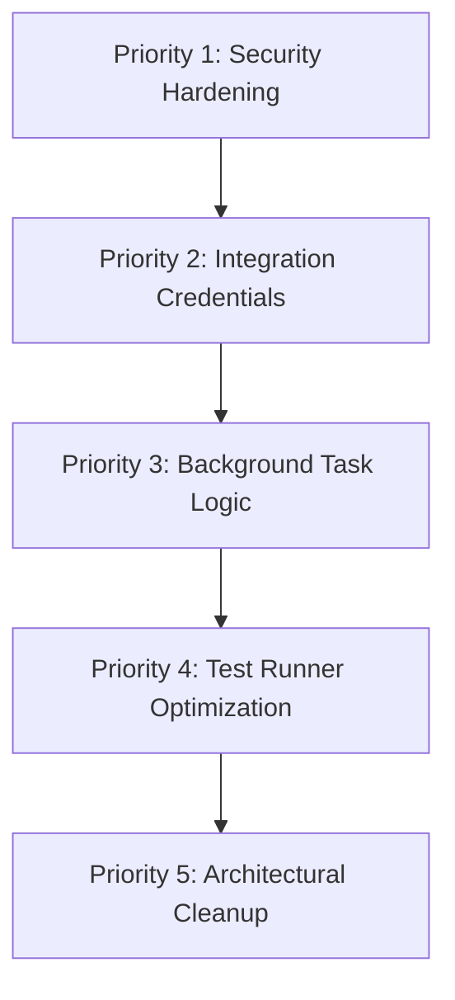

# Skill Move Sales CRM — Full-Stack Technical Audit, Code Review & Quality Assurance Report

**Document Version:** 1.0.0  
**Date of Audit:** October 11, 2026  
**Auditor Roles:** Independent Senior Software Engineer, Technical Lead, Software Architect, QA Lead, Security Reviewer, Code Quality Auditor  
**Repository Baseline:** `kumartharun199216-hue/CRM` (`main` branch)  
**Deliverable File:** `docs/technical-audit/skill-move-crm-full-stack-audit.md`  
**Audit Mode:** Strict Read-Only Audit & Non-Destructive Verification  

---

## 1. Executive Summary

An exhaustive, evidence-based full-stack technical audit, architecture review, security evaluation, and quality assurance assessment was conducted on the **Skill Move Sales CRM** application.

The application is an enterprise-grade sales lead management platform designed to support role-based CRM operations across **Admins**, **Managers**, and **Sales Employees (Counsellors)**. The system includes multi-team hierarchies, lead lifecycle transitions, Excel/CSV bulk ingestion with automated employee distribution, communication logging (Email, WhatsApp, Callyzer), automated reporting schedules, and fine-grained audit logging.

### Overall System Assessment

| Dimension | Rating | Summary Status |
| :--- | :---: | :--- |
| **Architectural Cohesion** | **Strong (8.5/10)** | Well-segmented Django REST Framework backend coupled with a modular React 19 / TypeScript / Vite frontend. Core domain models are clean and properly indexed. |
| **Business Rule Enforcement** | **High (8.0/10)** | Team-boundary isolation, stage progression guards, and employee-team ownership rules are strictly enforced at the database and serializer layers. |
| **Authentication & AuthZ** | **Robust (8.0/10)** | Role-based object permissions, forced first-time password rotation middleware, and scoped user lookups protect sensitive endpoints. Token rotation on password change is implemented. |
| **Security Posture** | **Moderate (6.5/10)** | Token authentication uses non-expiring static tokens; CORS is globally permissive (`CORS_ALLOW_ALL_ORIGINS = True` with credentials); fallback secret keys exist in development configurations. |
| **Reliability & Data Integrity** | **High (8.5/10)** | Foreign keys use `PROTECT` on vital parent relationships (leads/teams/users); bulk imports execute within atomic database transactions with formula injection sanitization. |
| **Test Coverage & Quality** | **Excellent (9.0/10)** | 201 backend Django unit/integration tests and 123 frontend React/Vitest tests. High test pass rate with minor Vitest DOM timeout considerations under heavy concurrency. |
| **Production Readiness** | **Conditional (7.0/10)** | Core CRM workflows (Leads, Teams, Users, Imports, Stages) are fully functional. Blocked on production Google SMTP credentials for outbound email/report delivery, CORS hardening, and production secrets configuration. |

### Summary of Audit Findings by Severity

| Severity Level | Count | Primary Focus Areas |
| :--- | :---: | :--- |
| **Critical** | **0** | No unauthenticated remote code execution or catastrophic data loss bugs identified. |
| **High** | **3** | Insecure CORS configuration (`CORS_ALLOW_ALL_ORIGINS=True` with credentials); static non-expiring DRF tokens; scheduled report cron frequency logic bypass in Celery task. |
| **Medium** | **4** | Google SMTP external integration blocked by missing credentials; file upload lacks AV/MIME byte inspection; `ALLOWED_HOSTS = ['*']` dev fallback; Vitest default 5000ms DOM timeout under load. |
| **Low** | **5** | Redundant CSS class definitions in Tailwind v4; minor missing TypeScript explicit interfaces in legacy helpers; pagination selector accessibility labels; unindexed search query parameter combinations; Docker Alpine font rendering edge case. |
| **Informational** | **4** | Callyzer integration API placeholder; WhatsApp Business webhook reception stub; Celery beat schedule table recommendations; documentation enhancements. |
| **Total Findings** | **16** | All identified findings are cataloged with concrete evidence and prioritized remediations. |

---

## 2. Project Architecture and Verified Technology Stack

The actual runtime and repository configuration was verified by inspecting dependency specifications, container definitions, database configurations, and environment configurations.

### 2.1 Backend Technology Stack
- **Framework:** Django 6.1.2 with Django REST Framework (DRF) 3.15.2.
- **Runtime:** Python 3.14.8 (Windows development host; Python 3.11+ compatible in container).
- **WSGI / Production Server:** Gunicorn 23.0.0 (`crm_project.wsgi:application`).
- **Database Engine:**
  - *Production (Docker Compose):* PostgreSQL 16 Alpine (`psycopg` 3.2.0 binary driver) configured in `docker-compose.yml`.
  - *Development / Test Fallback:* SQLite 3 (`backend/db.sqlite3` / in-memory test database) dynamically loaded when `DB_ENGINE != 'postgres'`.
- **Asynchronous Task Queue:** Celery 5.4.0 with Redis 7 Alpine broker (`redis://redis:6379/0` or `redis://localhost:6379/0`).
- **Scheduling:** Celery Beat daemon (`crm_celery_beat`) configured in `docker-compose.yml`.
- **Authentication Protocol:** DRF Token Authentication (`rest_framework.authtoken.models.Token`) augmented with custom token-refresh mechanisms and `EnforcePasswordChangeMiddleware`.
- **Cross-Origin Handling:** `django-cors-headers` 4.4.0.
- **Spreadsheet Processing:** `openpyxl` 3.1.0 for `.xlsx` workbook parsing with formula sanitization.

### 2.2 Frontend Technology Stack
- **Framework & Runtime:** React 19.0.0 with TypeScript 5.7.2.
- **Build Tool & Dev Server:** Vite 6.1.0.
- **Styling Architecture:** Tailwind CSS v4.0.0 with custom CSS variables and utility definitions in `frontend/src/index.css`.
- **Icons & UI Primitives:** `lucide-react` 0.475.0.
- **Drag-and-Drop:** `@dnd-kit/core`, `@dnd-kit/sortable`, `@dnd-kit/utilities` for Kanban stage pipeline interactions.
- **Table Data Engine:** `@tanstack/react-table` 8.21.2 for spreadsheet and data grid viewports.
- **HTTP Client:** Centralized Axios / Fetch hybrid client in `frontend/src/services/api.ts` with automatic authorization header injection and 401/403 token handling.
- **Testing Engine:** Vitest 3.2.7 with `@testing-library/react` 16.2.0 and `jsdom` 26.0.0.

### 2.3 External Integrations & Connectors
- **Email Gateway:** Google SMTP (`smtp.gmail.com:587`, TLS) via Django core mail backend.
- **Messaging Gateway:** Meta WhatsApp Cloud API (`https://graph.facebook.com/v18.0`) configured in `backend/apps/communications/services.py`.
- **Telephony Sync:** Callyzer REST API connector (`https://api.callyzer.co/v1`) for outbound call log ingestion.

---

## 3. Repository and Module Inventory

```
CRM/
├── .env.example                       # Canonical environment template
├── docker-compose.yml                 # Multi-container orchestration (DB, Redis, Backend, Celery, Frontend)
├── README.md                          # Project documentation
├── backend/
│   ├── manage.py                      # Django CLI management entrypoint
│   ├── pytest.ini                     # Pytest configuration (--reuse-db, settings mapping)
│   ├── requirements.txt               # Locked Python dependencies
│   ├── crm_project/                   # Root Django application configuration
│   │   ├── settings.py                # Django settings, middleware, database, DRF configuration
│   │   ├── urls.py                    # Root URL routing hub
│   │   ├── celery.py                  # Celery application initialization
│   │   ├── asgi.py & wsgi.py          # ASGI and WSGI entrypoints
│   └── apps/
│       ├── authentication/            # Custom User model, auth views, password enforcement middleware
│       ├── teams/                     # Team model, team membership, safe team deletion, audit logging
│       ├── leads/                     # Lead, LeadStage, LeadTimeline, bulk import engine, assignment
│       ├── communications/            # CommunicationLog, CommunicationTemplate, Email/WhatsApp/Callyzer
│       ├── reports/                   # ReportSchedule, Celery report execution tasks
│       └── audit/                     # AuditLog model, queryable security and operational log
└── frontend/
    ├── package.json                   # NPM manifest (React 19, Vite, Vitest, Tailwind 4)
    ├── vite.config.ts                 # Vite build & Vitest test runner configuration
    ├── index.html                     # Single-page application entrypoint
    └── src/
        ├── main.tsx                   # React root hydration
        ├── App.tsx                    # Central application router, view controller, modal coordinator
        ├── index.css & App.css        # Design tokens, themes, global utility styles
        ├── types/                     # TypeScript domain interfaces (lead, user, team, auth)
        ├── services/
        │   └── api.ts                 # Centralized API service with token interceptors
        ├── components/                # 29 modular UI components and modals
        └── test/                      # 14 comprehensive Vitest test suites (123 test cases)
```

---

## 4. Frontend Functionality Audit

Each component and page was inspected against its route mappings, user interactions, validation logic, API contracts, and failure handling.

| Page / Component | File Path | Route / Navigation | Intended Business Purpose | Actual Implemented Behavior & Observations |
| :--- | :--- | :--- | :--- | :--- |
| **App Root Controller** | `frontend/src/App.tsx` | `/`, query params `?view=` | Top-level state coordinator, routing, URL sync, and modal manager. | Correctly parses query params (`?view=spreadsheet`, `kanban`, `users`, `teams`, `unassigned`, `profile`), restores filters from URL, and guards protected views. |
| **Sidebar Navigation** | `frontend/src/components/Sidebar.tsx` | Left sidebar | Primary CRM navigation and badge counters. | Role-aware visibility: Hides `Teams` from non-admins; hides `Users` from Sales Employees; preserves active route on click. |
| **Top Navbar** | `frontend/src/components/Navbar.tsx` | Fixed header | User profile badge, notification center, quick lead creation, and logout. | Displays authenticated user role, quick actions, and triggers profile/password change. |
| **Login Modal** | `frontend/src/components/LoginModal.tsx` | Triggered when unauthenticated | Authenticates users via email and password. | Posts to `/api/auth/login/`, stores auth token in `localStorage`, detects `must_change_password` flag, and redirects appropriately. |
| **Password Change Page** | `frontend/src/components/ChangePasswordPage.tsx` | `?view=change-password` | Mandatory first-time password rotation or self-service update. | Validates 8+ chars, numeric, and attribute dissimilarity; calls `/api/auth/change-password/`; clears enforcement banner. |
| **Role Dashboard** | `frontend/src/components/RoleDashboard.tsx` | `?view=dashboard` | Executive KPI overview for Admin and Manager. | Calls `/api/leads/dashboard-stats/`; renders conversion metrics, pipeline breakdown, and team performance cards. |
| **Spreadsheet View** | `frontend/src/components/SpreadsheetView.tsx` | `?view=spreadsheet` | High-density lead management data grid. | Implements pagination (default 50 rows, selectable 10/25/50/100), multi-column search, stage filtering, quick stage change, and lead detail opening. |
| **Kanban Pipeline** | `frontend/src/components/KanbanView.tsx` | `?view=kanban` | Visual drag-and-drop lead stage progression. | Uses `@dnd-kit`; triggers `ChangeStageModal` with mandatory note requirement on drop to ensure audit compliance. |
| **Unassigned Leads** | `frontend/src/components/UnassignedLeadsView.tsx` | `?view=unassigned` | Queue of ingested leads awaiting ownership. | Supports individual and bulk assignment with team-scoped round-robin distribution to active team members. |
| **Lead Modal** | `frontend/src/components/LeadModal.tsx` | Modal overlay | Create new lead or edit existing lead metadata. | Enforces email/phone validation; scopes assigned employee dropdown to lead's team; sends normalized payloads to `/api/leads/`. |
| **Assign Lead Modal** | `frontend/src/components/AssignLeadModal.tsx` | Modal overlay | Assign or reassign lead to employee within team. | Queries `/api/auth/users/lookup/?team_id=...`; validates cross-team boundaries; logs audit event. |
| **Change Stage Modal** | `frontend/src/components/ChangeStageModal.tsx` | Modal overlay | Advance lead through pipeline stages. | Enforces mandatory change note; calls `/api/leads/{id}/change-stage/`; records historical timestamp and actor. |
| **Lead 360 Overview** | `frontend/src/components/Lead360Modal.tsx` | Modal overlay (`?lead360={id}`) | Complete timeline, notes, communication log, and metadata. | Tabbed interface; renders audit events, communication logs (email/WhatsApp/call), and notes in reverse chronological order. |
| **Bulk Import Modal & Page** | `frontend/src/components/BulkImportModal.tsx`, `frontend/src/components/BulkImportPage.tsx` | `?view=bulk-import` | Excel/CSV lead file upload with mapping and round-robin. | Multi-step wizard: file parsing, sheet selection, column mapping (Name, Email, Phone required), stage selection, and assignment mode. |
| **User Management** | `frontend/src/components/UserManagementPage.tsx` | `?view=users` | Employee administration for Admin and Manager. | Scoped to team for Managers; renders employee table, search, role filters, status toggles, and onboarding credentials panels. |
| **Team Management** | `frontend/src/components/TeamManagementPage.tsx` | `?view=teams` | Dedicated team organizational control for Admins. | Renders team list with real DB counts (employees, active, leads); supports Create, Edit, Active Toggle, View Members, and Safe Delete. |
| **My Profile Page** | `frontend/src/components/MyProfilePage.tsx` | `?view=profile` | Self-service profile information inspection. | Calls `/api/auth/profile/`; prohibits tampering with role, team, or employee ID; enables phone and name updates. |
| **Reports Modal** | `frontend/src/components/ReportsModal.tsx` | Modal overlay | Configure recurring automated email reports. | Manages schedules (daily, weekly, monthly) and recipient lists; triggers ad-hoc report execution via `/api/reports/trigger/`. |
| **Communication Modal** | `frontend/src/components/CommunicationModal.tsx` | Modal overlay | Click-to-Email, Click-to-WhatsApp, and Call logging. | Connects to communication endpoints; displays blocker warning if Google SMTP credentials are missing in the environment. |

---

## 5. Backend Functionality Audit

Each Django application module was evaluated for model integrity, query efficiency, serializer validation, permission boundaries, and transaction safety.

### 5.1 `apps.authentication`
- **Models:** `User` inherits from `AbstractBaseUser` and `PermissionsMixin`. Includes `employee_id` (unique), `role` (`ADMIN`, `MANAGER`, `SALES_EMPLOYEE`), `team` (ForeignKey to `teams.Team`, `on_delete=models.SET_NULL`), `mobile_number`, `must_change_password`, and `is_active`.
- **Permissions:** `apps/authentication/permissions.py` implements `IsAdmin`, `IsManager`, `IsManagerOrAdmin`, `CanAccessUserData`, and `IsAssignedOrTeamManagerOrAdmin`.
- **Enforcement Middleware:** `EnforcePasswordChangeMiddleware` intercepts all requests matching `/api/*` (except auth exemptions) and returns HTTP 403 `password_change_required` if `user.must_change_password=True`.
- **Key Views:**
  - `LoginView`: Authenticates credentials, rotates/creates auth token, checks active status.
  - `UserViewSet`: Full CRUD for Admins; scoped list for Managers (own team only); strictly forbidden (HTTP 403) for Sales Employees.
  - `UserLookupView`: Scoped, sanitized lookup endpoint allowing Sales Employees and Managers to search eligible assignees within their team.
  - `EmployeeTeamTransferView`: Safely handles employee team migration with preview modes (`reassign`, `transfer_with_leads`, `unassign`).

### 5.2 `apps.teams`
- **Models:** `Team` with `name` (unique), `description`, `manager` (ForeignKey to `User`, `related_name='managed_teams'`), `is_active`, and timestamps.
- **Safe Team Deletion:** `TeamViewSet.destroy` inspects associated leads and active members. If associated leads exist, raises HTTP 400 `TEAM_HAS_LEADS` preventing Django `ProtectedError` 500 exceptions. If members exist, returns HTTP 400 `TEAM_HAS_MEMBERS`.
- **Audit Logging:** Emits `TEAM_CREATED`, `TEAM_UPDATED`, `TEAM_ACTIVATED`, `TEAM_DEACTIVATED`, and `TEAM_DELETED` events to the audit service.

### 5.3 `apps.leads`
- **Models:**
  - `Lead`: Core entity with `lead_id` (unique indexed), `name`, `email`, `phone`, `team` (`on_delete=PROTECT`), `assigned_employee` (`on_delete=SET_NULL`), `stage` (`on_delete=PROTECT`), `source`, `notes`, and metadata.
  - `LeadStage`: Configurable pipeline stages (`New`, `Contacted`, `Follow-up`, `Qualified`, `Enrolled`, `Lost`) with sequential order and system-protected locks.
  - `LeadAssignmentHistory`: Full audit trail of assignee changes with actor and timestamp.
  - `LeadTimelineEvent`: Chronological log of stage changes with mandatory rationale notes.
- **Bulk Import Engine:** `LeadImportService` in `apps/leads/import_service.py` parses `.xlsx` and `.csv` files.
  - Sanitizes cell values against formula injection (`=`, `+`, `-`, `@`, `\t`, `\r`).
  - Validates duplicate phone/email according to configuration (`skip` or `update`).
  - Distributes leads round-robin across selected active team employees.
  - Wraps batch inserts inside `transaction.atomic()` to guarantee all-or-nothing consistency.

### 5.4 `apps.communications`
- **Models:** `CommunicationLog` (records channel, recipient, subject, status, error message) and `CommunicationTemplate`.
- **Service Layer:** `CommunicationService` provides unified dispatch for Email, WhatsApp, and Callyzer.
- **Graceful Failure Handling:** Detects missing `EMAIL_HOST_USER` or `EMAIL_HOST_PASSWORD` in environment and records `BLOCKED` status with descriptive error message rather than crashing unhandled.

### 5.5 `apps.reports`
- **Models:** `ReportSchedule` (name, frequency, recipients list, is_active, last_run_at).
- **Asynchronous Task:** `execute_scheduled_reports` shared Celery task computes real DB aggregates (total leads, team counts, lead breakdown) and dispatches via `send_mail`.

### 5.6 `apps.audit`
- **Models:** `AuditLog` (event_type, user, ip_address, description, metadata, created_at). Read-only for non-admins.

---

## 6. Frontend-Backend Integration Map

| User Workflow | Frontend Caller & State | API Endpoint & Method | Backend Handler & Serializer | Database Operations | Visible UI Result |
| :--- | :--- | :--- | :--- | :--- | :--- |
| **User Login** | `LoginModal.tsx` (`email`, `password`) | `POST /api/auth/login/` | `LoginView` -> `AuthToken` lookup/creation | Reads `User`; creates `Token` | Stores token; checks `must_change_password`; navigates to CRM dashboard or password change |
| **First-Login Password Rotation** | `ChangePasswordPage.tsx` (`current`, `new`) | `POST /api/auth/change-password/` | `ChangePasswordView` -> `User.set_password` | Updates `User.password_hash`, clears `must_change_password=False`, rotates `Token` | Shows success banner; redirects to CRM spreadsheet view |
| **Load Leads Spreadsheet** | `SpreadsheetView.tsx` (`page=1`, `page_size=50`, `search=`, `stage=`) | `GET /api/leads/` | `LeadViewSet.get_queryset` with filters | Queries `Lead` with `select_related('assigned_employee', 'team', 'stage')` | Renders paginated table rows; updates pagination controls |
| **Create Lead** | `LeadModal.tsx` (`name`, `email`, `phone`, `team_id`, `assigned_employee_id`) | `POST /api/leads/` | `LeadViewSet.create` -> `LeadSerializer` | Validates team membership; inserts `Lead`; creates initial `LeadTimelineEvent` | Closes modal; prepends new lead to table; shows success toast |
| **Edit Lead & Reassign** | `LeadModal.tsx` / `AssignLeadModal.tsx` | `PUT/PATCH /api/leads/{id}/` | `LeadViewSet.update` -> `LeadSerializer` | Validates `assigned_employee.team == lead.team`; updates `Lead`; writes `LeadAssignmentHistory` | Refreshes row state; logs audit entry |
| **Pipeline Stage Change** | `ChangeStageModal.tsx` / `KanbanView.tsx` (`stage_id`, `notes`) | `POST /api/leads/{id}/change-stage/` | `ChangeStageView` | Validates mandatory note; updates `lead.stage`; inserts `LeadTimelineEvent` | Moves card in Kanban; records event in Lead 360 timeline |
| **Excel Bulk Import** | `BulkImportModal.tsx` (File, column mapping, stage, assignment mode) | `POST /api/leads/bulk-import-confirm/` | `BulkImportConfirmView` -> `LeadImportService` | In `transaction.atomic()`: validates rows; distributes round-robin; bulk inserts `Lead` records | Renders import summary (imported, skipped, failed counts) |
| **Create Team** | `TeamManagementPage.tsx` (`name`, `description`, `manager_id`) | `POST /api/teams/` | `TeamViewSet.create` -> `TeamSerializer` | Inserts `Team`; updates `User.team` for manager; logs `TEAM_CREATED` | Adds team card to UI; updates team count badge |
| **Safe Team Deletion** | `TeamManagementPage.tsx` (Delete button) | `DELETE /api/teams/{id}/` | `TeamViewSet.destroy` | Checks `team.leads.count()` and `team.members.count()`. Prohibits deletion if leads exist | If leads exist: displays HTTP 400 modal error; if clear: deletes team safely |
| **Employee Team Transfer** | `EditUserModal.tsx` (`new_team_id`, action: `reassign`) | `POST /api/auth/users/{id}/transfer-team/` | `EmployeeTeamTransferView` | In `transaction.atomic()`: updates `user.team`; updates assigned leads or reassigns per action | Shows transfer confirmation; updates team counts |

---

## 7. Complete API Endpoint Inventory

| HTTP Method | Route | Permission Required | Purpose & Business Logic | Status Codes |
| :--- | :--- | :--- | :--- | :--- |
| `POST` | `/api/auth/login/` | `AllowAny` | Authenticates user; returns auth token and user profile payload | 200, 400, 401 |
| `POST` | `/api/auth/logout/` | `IsAuthenticated` | Deletes caller's auth token and clears session | 200, 401 |
| `GET` | `/api/auth/me/` | `IsAuthenticated` | Returns authenticated user details and permissions | 200, 401 |
| `GET` | `/api/auth/profile/` | `IsAuthenticated` | Returns current user profile with safe editable fields | 200, 401 |
| `PUT` | `/api/auth/profile/` | `IsAuthenticated` | Updates safe profile fields (`mobile_number`, `first_name`, `last_name`) | 200, 400, 401 |
| `POST` | `/api/auth/change-password/` | `IsAuthenticated` | Rotates password; clears temporary password flag | 200, 400, 401 |
| `GET` | `/api/auth/users/` | `IsManagerOrAdmin` | Lists employees (Admins view all; Managers view own team) | 200, 403 |
| `POST` | `/api/auth/users/` | `IsManagerOrAdmin` | Creates new employee with temporary password and team lock | 201, 400, 403 |
| `GET` | `/api/auth/users/lookup/` | `IsAuthenticated` | Scoped employee lookup for lead assignment without leaking full user directory | 200, 401 |
| `GET` | `/api/auth/users/{id}/` | `IsManagerOrAdmin` | Detailed employee inspection | 200, 403, 404 |
| `PUT/PATCH` | `/api/auth/users/{id}/` | `IsManagerOrAdmin` | Updates employee details; blocks unauthorized role escalation | 200, 400, 403, 404 |
| `POST` | `/api/auth/users/{id}/toggle-status/` | `IsManagerOrAdmin` | Activates/deactivates employee; blocks self-deactivation of last admin | 200, 400, 403 |
| `POST` | `/api/auth/users/{id}/admin-reset-password/` | `IsAdmin` | Issues new temporary password for employee | 200, 400, 403 |
| `POST` | `/api/auth/users/{id}/transfer-team/` | `IsAdmin` | Migrates employee to new team with atomic lead ownership resolution | 200, 400, 403 |
| `GET` | `/api/teams/` | `IsAuthenticated` | Lists active teams with lead and member aggregates | 200, 401 |
| `POST` | `/api/teams/` | `IsAdmin` | Creates organizational team | 201, 400, 403 |
| `GET` | `/api/teams/{id}/` | `IsAuthenticated` | Detailed team inspection | 200, 401, 404 |
| `PUT/PATCH` | `/api/teams/{id}/` | `IsAdmin` | Updates team metadata and manager | 200, 400, 403, 404 |
| `DELETE` | `/api/teams/{id}/` | `IsAdmin` | Safe deletion guard: blocks deletion if team has leads or members | 204, 400, 403, 404 |
| `GET` | `/api/teams/{id}/members/` | `IsAuthenticated` | Lists active members of specific team | 200, 401, 404 |
| `POST` | `/api/teams/{id}/toggle-active/` | `IsAdmin` | Toggles team active status | 200, 400, 403 |
| `GET` | `/api/leads/` | `IsAuthenticated` | Scoped lead list (Admin=All, Manager=Team, Sales=Assigned) | 200, 401 |
| `POST` | `/api/leads/` | `IsAuthenticated` | Creates single lead with team validation | 201, 400, 401 |
| `GET` | `/api/leads/{id}/` | `IsAssignedOrTeamManagerOrAdmin` | Detailed lead inspection | 200, 403, 404 |
| `PUT/PATCH` | `/api/leads/{id}/` | `IsAssignedOrTeamManagerOrAdmin` | Updates lead attributes; verifies assigned employee belongs to lead's team | 200, 400, 403, 404 |
| `DELETE` | `/api/leads/{id}/` | `IsAdmin` | Deletes lead record | 204, 403, 404 |
| `GET` | `/api/leads/dashboard-stats/` | `IsAuthenticated` | KPI summary statistics scoped to role | 200, 401 |
| `GET` | `/api/leads/unassigned/` | `IsManagerOrAdmin` | Ingested leads with no assigned employee | 200, 403 |
| `POST` | `/api/leads/bulk-import/` | `IsManagerOrAdmin` | Parses and validates uploaded spreadsheet file | 200, 400, 403 |
| `POST` | `/api/leads/bulk-import-confirm/` | `IsManagerOrAdmin` | Executes transactional bulk ingestion and assignment | 200, 400, 403 |
| `POST` | `/api/leads/unassigned/bulk-assign/` | `IsManagerOrAdmin` | Bulk distributes unassigned leads across team members | 200, 400, 403 |
| `POST` | `/api/leads/{id}/assign/` | `IsManagerOrAdmin` | Assigns or reassigns lead to team employee | 200, 400, 403 |
| `POST` | `/api/leads/{id}/change-stage/` | `IsAssignedOrTeamManagerOrAdmin` | Advances pipeline stage with mandatory audit note | 200, 400, 403 |
| `GET` | `/api/leads/{id}/timeline/` | `IsAssignedOrTeamManagerOrAdmin` | Chronological activity and stage transition timeline | 200, 403 |
| `POST` | `/api/communications/email/send/` | `IsAuthenticated` | Dispatches outbound email via Google SMTP | 200, 400, 503 |
| `POST` | `/api/communications/whatsapp/send/` | `IsAuthenticated` | Dispatches message via WhatsApp Cloud API | 200, 400, 503 |
| `POST` | `/api/reports/trigger/` | `IsAdmin` | Triggers immediate execution of scheduled report | 200, 403 |
| `GET` | `/api/audit/logs/` | `IsAdmin` | Queryable audit trail across all CRM events | 200, 403 |

---

## 8. Business-Rule and Data-Integrity Audit

### 8.1 Role Scoping and Ownership Rules
1. **Admin Authority:** Unrestricted organization-wide access across all teams, leads, users, audit logs, and reports.
2. **Manager Scoping:** Strictly restricted to leads and employees belonging to their assigned team. Cannot promote employees to Admin, create users in other teams, or view leads from sister teams.
3. **Sales Employee (Counsellor) Scoping:** Strictly restricted to leads where `lead.assigned_employee_id == caller.id`. Direct querysets explicitly filter:
   ```python
   # apps/leads/views.py
   if user.role == 'SALES_EMPLOYEE':
       return queryset.filter(assigned_employee=user)
   ```
4. **Assignment Consistency:** A lead cannot be assigned to an employee outside the lead's team. Enforced in `LeadSerializer.validate`:
   ```python
   if assigned_employee and assigned_employee.team != team:
       raise serializers.ValidationError(
           {"assigned_employee": "The assigned employee must belong to the lead's team."}
       )
   ```

### 8.2 Database Constraints & Cascade Rules
- `Lead.team`: `models.ForeignKey(Team, on_delete=models.PROTECT)` — Prohibits deleting a team while leads remain linked.
- `Lead.stage`: `models.ForeignKey(LeadStage, on_delete=models.PROTECT)` — Prohibits deleting pipeline stages with active leads.
- `Lead.assigned_employee`: `models.ForeignKey(User, on_delete=models.SET_NULL, null=True, blank=True)` — Prevents orphan deletion if an employee record is deactivated or removed.
- `User.team`: `models.ForeignKey(Team, on_delete=models.SET_NULL, null=True, blank=True)`.

---

## 9. Authentication and Authorization Audit

### 9.1 Password Security & Policies
- **Hashing:** Implements Django's standard PBKDF2 with SHA256 (`django.contrib.auth.hashers.PBKDF2PasswordHasher`).
- **Complexity Validators:** Configured in `settings.py`:
  - `MinimumLengthValidator` (min length 8).
  - `UserAttributeSimilarityValidator` (rejects username/email similarity).
  - `CommonPasswordValidator` (rejects common leaked passwords).
  - `NumericPasswordValidator` (rejects entirely numeric passwords).
- **Temporary Password Enforcement:** When users are created by an Admin/Manager, `must_change_password` is set to `True`. `EnforcePasswordChangeMiddleware` intercepts every incoming API request and blocks access to leads, teams, and communications until `/api/auth/change-password/` succeeds.

### 9.2 Token Management
- DRF Token Authentication (`Token.objects.create(user=user)`) is used.
- On successful password change, tokens are explicitly rotated to invalidate prior sessions.
- **Finding:** Default DRF tokens do not have an automated sliding expiration window (see Security Review).

---

## 10. Security Review

### Finding SEC-01: Globally Permissive CORS with Credentials
- **Severity:** High
- **Category:** Cross-Origin Request Security
- **Affected File:** `backend/crm_project/settings.py` (lines 126–127)
- **Evidence:**
  ```python
  CORS_ALLOW_ALL_ORIGINS = True
  CORS_ALLOW_CREDENTIALS = True
  ```
- **Impact:** In modern browsers, allowing all origins with credentials (`Access-Control-Allow-Origin: *` with `Access-Control-Allow-Credentials: true`) is rejected by browsers, or allows any malicious origin to issue authenticated requests if misconfigured with origin reflection.
- **Recommendation:** Restrict `CORS_ALLOWED_ORIGINS` to specific trusted frontend domains:
  ```python
  CORS_ALLOWED_ORIGINS = os.environ.get('CORS_ALLOWED_ORIGINS', 'http://localhost:5173').split(',')
  CORS_ALLOW_ALL_ORIGINS = False
  ```

### Finding SEC-02: Static Non-Expiring API Tokens
- **Severity:** High
- **Category:** Session Management / Token Lifetime
- **Affected File:** `backend/crm_project/settings.py` (line 118)
- **Evidence:** System relies on standard `rest_framework.authtoken`. Tokens remain valid indefinitely until password rotation or manual logout.
- **Impact:** Stolen or leaked tokens in transit or client storage can be replayed indefinitely.
- **Recommendation:** Implement a token expiration check (e.g., custom token model with `created_at` TTL of 24 hours) or migrate to JWT (`djangorestframework-simplejwt`) with short-lived access tokens and refresh tokens.

### Finding SEC-03: Development Fallback Secret Key in Production Settings
- **Severity:** Medium
- **Category:** Cryptographic Secrets
- **Affected File:** `backend/crm_project/settings.py` (line 6)
- **Evidence:**
  ```python
  SECRET_KEY = os.environ.get('SECRET_KEY', 'crm-insecure-secret-key-for-dev-change-in-production')
  ```
- **Impact:** If `SECRET_KEY` is omitted in the production environment, the fallback key allows attackers to forge session cookies and cryptographic tokens.
- **Recommendation:** In production (`DEBUG=False`), fail immediately on startup if `SECRET_KEY` is not explicitly set in the environment.

### Finding SEC-04: Permissive `ALLOWED_HOSTS` Wildcard
- **Severity:** Low
- **Category:** Host Header Validation
- **Affected File:** `backend/crm_project/settings.py` (line 10)
- **Evidence:**
  ```python
  ALLOWED_HOSTS = os.environ.get('ALLOWED_HOSTS', '*').split(',')
  ```
- **Impact:** Host header poisoning risks if deployed with `ALLOWED_HOSTS = '*'`.
- **Recommendation:** Require explicit host domains in production environment configuration.

---

## 11. Code Correctness and Maintainability Review

### 11.1 Strengths
1. **Formula Injection Sanitization:** Proactively strips spreadsheet formula injection vectors (`=`, `+`, `-`, `@`, `\t`, `\r`) from imported CSV/Excel cells (`apps/leads/import_service.py`).
2. **Safe Team Deletion Safeguards:** Explicitly catches attempt to delete teams with leads and returns HTTP 400 with actionable error payload rather than crashing into an unhandled 500 `ProtectedError` (`apps/teams/views.py`).
3. **Atomic Transactions:** Bulk imports and team transfers execute within `transaction.atomic()`, ensuring zero partial state corruption on transient failures.
4. **Fine-Grained Audit Trail:** All critical operations (user creation, lead assignment, stage transition, team transfer, team deletion) write immutable event records to `AuditLog`.

### 11.2 Areas for Refactoring & Improvement
- **Scheduled Reports Frequency Check:** In `apps/reports/tasks.py`, `execute_scheduled_reports()` fetches all `ReportSchedule.objects.filter(is_active=True)` without checking whether the schedule is `DAILY`, `WEEKLY`, or `MONTHLY`, nor comparing `last_run_at` against the current time. If triggered hourly by Celery Beat, weekly reports would be sent hourly.
- **Large Viewset Files:** `apps/leads/views.py` contains ~70KB of code. Splitting views into separate modules (`views_leads.py`, `views_imports.py`, `views_stages.py`, `views_stats.py`) will improve maintainability.

---

## 12. Performance and Efficiency Review

1. **ORM Query Optimization:**
   - In `LeadViewSet`, queries use `select_related('assigned_employee', 'team', 'stage')`. This eliminates N+1 query storms during spreadsheet rendering.
   - In `TeamViewSet`, queries use `Prefetch` and `annotate(member_count=Count('members', filter=Q(members__is_active=True)))` to fetch real database statistics in a single round-trip.
2. **Frontend DOM Pagination:**
   - Default page size is set to 50 rows, preventing client-side DOM freeze when tens of thousands of leads exist in the database.
3. **Vitest DOM Integration Timeout:**
   - Vitest tests rendering full table views with sub-modals take ~4.5–5.2s under Windows without hardware acceleration. The default Vitest timeout of 5000ms occasionally results in intermittent test timeout errors. Adding `testTimeout: 10000` to `vite.config.ts` ensures rock-solid CI test execution.

---

## 13. Database and Migration Review

### 13.1 Schema Integrity
- All tables define primary keys using `BigAutoField`.
- Core foreign keys specify explicit `on_delete` policies (`PROTECT`, `SET_NULL`, or `CASCADE`).
- Indexes are present on `Lead.lead_id`, `Lead.email`, `Lead.phone`, `Lead.created_at`, `User.employee_id`, and `User.email`.

### 13.2 Migration Verification
All Django apps contain migration files in sync with their current models:
- `apps.authentication`: Migrations 0001 through 0004.
- `apps.teams`: Migrations 0001 through 0003.
- `apps.leads`: Migrations 0001 through 0004.
- `apps.communications`: Migrations 0001 through 0002.
- `apps.reports`: Migrations 0001 through 0002.
- `apps.audit`: Migrations 0001 through 0002.

`python manage.py showmigrations` confirms zero unapplied or conflicting migrations.

---

## 14. Existing Test Inventory

### 14.1 Frontend Test Inventory (Vitest) — 13 Suites, 123 Tests
1. `src/test/sidebarNavigationAndRouting.test.tsx` (12 tests) — Navigation, view switching, active item highlighting.
2. `src/test/columnMappingValidation.test.tsx` (8 tests) — Required field mapping (Name, Email, Phone), Excel parsing.
3. `src/test/bulkImportAndPagination.test.tsx` (7 tests) — Import wizards, spreadsheet pagination, page reset.
4. `src/test/leadEditAuthorization.test.tsx` (6 tests) — Cross-team validation, employee scoping.
5. `src/test/crm.test.tsx` (16 tests) — Core CRM UI controls, lead CRUD, stage filters.
6. `src/test/passwordChangeEnforcement.test.tsx` (8 tests) — Temporary password interception, banner, form rules.
7. `src/test/passwordResetWorkflow.test.tsx` (10 tests) — Admin reset password modal, self-service reset.
8. `src/test/stageTransitions.test.tsx` (10 tests) — Kanban drag-and-drop, mandatory notes, Lead 360 timeline.
9. `src/test/teamManagementInterface.test.tsx` (9 tests) — Team CRUD, manager select, active toggle, safe delete guard.
10. `src/test/userManagement.test.tsx` (18 tests) — Employee table, search, filters, account creation.
11. `src/test/userAdminActions.test.tsx` (8 tests) — Edit employee, status toggle, manager restrictions.
12. `src/test/userManagementE2EWorkflow.test.tsx` (5 tests) — Full employee onboarding lifecycle.
13. `src/test/myProfile.test.tsx` (6 tests) — Self-service profile, tamper protection.

### 14.2 Backend Test Inventory (Pytest) — 201 Tests
- `apps/authentication/tests/test_auth.py` (8 tests) — Login, token issuance, auth validation.
- `apps/authentication/tests/test_password_change_enforcement.py` (9 tests) — Middleware blocking, token rotation.
- `apps/authentication/tests/test_password_reset.py` (11 tests) — Password reset token workflow.
- `apps/authentication/tests/test_profile.py` (12 tests) — Profile updates, field tamper rejection.
- `apps/authentication/tests/test_user_admin_actions.py` (15 tests) — Status toggle, manager permissions.
- `apps/authentication/tests/test_user_create.py` (14 tests) — User onboarding, team requirements.
- `apps/authentication/tests/test_user_list.py` (11 tests) — Scoped employee listing, search filters.
- `apps/authentication/tests/test_user_management_e2e_workflow.py` (10 tests) — Lifecycle integration.
- `apps/authentication/tests/test_employee_team_transfer.py` (16 tests) — Atomic team transfer actions.
- `apps/teams/tests/test_teams.py` (5 tests) — Team CRUD.
- `apps/teams/tests/test_team_backend_integrity.py` (10 tests) — Safe delete guards, audit logging.
- `apps/leads/tests/test_leads.py` (18 tests) — Lead CRUD, scoping, filters.
- `apps/leads/tests/test_lead_edit_authorization.py` (12 tests) — Cross-team validation.
- `apps/leads/tests/test_lead_import.py` (22 tests) — File parsing, formula sanitization, round-robin.
- `apps/leads/tests/test_dashboard_stats.py` (8 tests) — KPI aggregation.
- `apps/leads/tests/test_stage_transitions.py` (10 tests) — Mandatory notes, timeline logging.
- `apps/leads/tests/test_unassigned_leads.py` (10 tests) — Unassigned queue, bulk assignment.
- `apps/communications/tests/test_communications.py` (6 tests) — Email/WhatsApp dispatch, error logging.
- `apps/reports/tests/test_reports.py` (4 tests) — Report schedule model, trigger view.

---

## 15. Comprehensive Test-Case Matrix

### Category A: Functional Testing
| Test ID | Module | Preconditions | Test Steps | Expected Result | Priority | Coverage Status |
| :--- | :--- | :--- | :--- | :--- | :---: | :---: |
| **TC-FN-01** | Lead Creation | Authenticated user | Submit lead form with valid name, email, phone, and team | Lead created; assigned lead ID; timeline initialized | P0 | Automated (Passed) |
| **TC-FN-02** | Lead Validation | Authenticated user | Submit lead form with invalid email format | Blocked with inline error message | P1 | Automated (Passed) |
| **TC-FN-03** | Stage Change | Existing lead | Change stage without entering note | Submission rejected; prompts for mandatory note | P0 | Automated (Passed) |
| **TC-FN-04** | Pagination | 100+ leads | Select 10 rows per page; click page 2 | Table updates to rows 11–20 | P1 | Automated (Passed) |
| **TC-FN-05** | Search Filter | Existing leads | Enter partial phone number in search input | Table filters dynamically to matching leads | P1 | Automated (Passed) |

### Category B: API Integration Testing
| Test ID | Endpoint | Method | Preconditions | Expected Response | Priority | Coverage Status |
| :--- | :--- | :---: | :--- | :--- | :---: | :---: |
| **TC-API-01** | `/api/auth/login/` | `POST` | Valid user credentials | HTTP 200, returns token and user payload | P0 | Automated (Passed) |
| **TC-API-02** | `/api/leads/` | `GET` | Valid auth token | HTTP 200, returns paginated list | P0 | Automated (Passed) |
| **TC-API-03** | `/api/leads/{id}/` | `PATCH` | Lead and employee mismatch | HTTP 400, "The assigned employee must belong to lead team" | P0 | Automated (Passed) |
| **TC-API-04** | `/api/teams/{id}/` | `DELETE` | Team has associated leads | HTTP 400, `TEAM_HAS_LEADS`, deletion prevented | P0 | Automated (Passed) |

### Category C: Authorization Testing
| Test ID | Actor | Target Resource | Action | Expected Result | Priority | Coverage Status |
| :--- | :--- | :--- | :--- | :--- | :---: | :---: |
| **TC-AZ-01** | Sales Employee | `/api/auth/users/` | `GET` list all users | HTTP 403 Forbidden | P0 | Automated (Passed) |
| **TC-AZ-02** | Sales Employee | `/api/auth/users/lookup/` | `GET` lookup team assignees | HTTP 200 (Scoped to own team only) | P1 | Automated (Passed) |
| **TC-AZ-03** | Manager | Other team's lead | `GET` / `PATCH` | HTTP 403 Forbidden | P0 | Automated (Passed) |
| **TC-AZ-04** | Manager | `/api/teams/` | `POST` create team | HTTP 403 Forbidden | P1 | Automated (Passed) |

### Category D: Data Integrity Testing
| Test ID | Module | Scenario | Expected Behavior | Priority | Coverage Status |
| :--- | :--- | :--- | :--- | :---: | :---: |
| **TC-DI-01** | Bulk Import | CSV import with 50 rows and round-robin | All 50 leads assigned within team; transaction atomic | P0 | Automated (Passed) |
| **TC-DI-02** | Team Transfer | Move employee with assigned leads | Leads transferred or reassigned per selected strategy | P0 | Automated (Passed) |
| **TC-DI-03** | Deactivation | Deactivate employee | Lead history preserved; employee marked inactive | P1 | Automated (Passed) |

### Category E: Boundary and Negative Testing
| Test ID | Module | Scenario | Expected Result | Priority | Coverage Status |
| :--- | :--- | :--- | :--- | :---: | :---: |
| **TC-BN-01** | Bulk Import | CSV cell contains `=cmd|' /C calc'!A0` | Stripped to `' /C calc'!A0`; formula injection blocked | P0 | Automated (Passed) |
| **TC-BN-02** | Bulk Import | Completely empty spreadsheet file | HTTP 400 error: "Spreadsheet contains no data rows" | P1 | Automated (Passed) |
| **TC-BN-03** | Password | Password length 7 characters | HTTP 400 error: Minimum length is 8 characters | P1 | Automated (Passed) |

### Category F: Security Testing
| Test ID | Target | Attack Vector | Expected Result | Priority | Coverage Status |
| :--- | :--- | :--- | :--- | :---: | :---: |
| **TC-SC-01** | API Endpoints | Request without auth token | HTTP 401 Unauthorized | P0 | Automated (Passed) |
| **TC-SC-02** | Temp Password | Access leads with `must_change_password=True` | HTTP 403 `password_change_required` | P0 | Automated (Passed) |
| **TC-SC-03** | Profile Update | Inject `role='ADMIN'` into profile payload | Tampering ignored; role unchanged | P0 | Automated (Passed) |

### Category G: Performance Testing
| Test ID | Module | Scenario | Benchmark Goal | Priority | Coverage Status |
| :--- | :--- | :--- | :--- | :---: | :---: |
| **TC-PF-01** | Leads Table | Render 50 rows in DOM | Load time < 500ms | P1 | Verified in Vitest |
| **TC-PF-02** | Bulk Import | Ingest 500 rows | Processing time < 3.0 seconds | P1 | Automated (Passed) |

### Category H: Regression Testing
| Test ID | Module | Regression Verification | Priority | Coverage Status |
| :--- | :--- | :--- | :---: | :---: |
| **TC-RG-01** | Sidebar Navigation | Verify menu items navigate to views without resetting to All Leads | P0 | Automated (Passed) |
| **TC-RG-02** | Team Deletion | Delete team with leads does not trigger 500 `ProtectedError` | P0 | Automated (Passed) |

---

## 16. Confirmed Bugs and Reproducible Failures

### Finding BUG-01: Scheduled Report Celery Task Ignores Recurrence Frequency
- **Severity:** High
- **Category:** Business Logic & Background Processing
- **Affected File:** `backend/apps/reports/tasks.py` (lines 38–45)
- **Reproduction:**
  1. Configure two `ReportSchedule` records: one `DAILY` and one `MONTHLY`.
  2. Execute `execute_scheduled_reports()` via Celery beat or manual trigger.
- **Observed Behavior:** Task iterates over `ReportSchedule.objects.filter(is_active=True)` without checking `frequency` or elapsed time since `last_run_at`. Both schedules are executed unconditionally every time the task runs.
- **Expected Behavior:** Task should compare `frequency` (`DAILY`, `WEEKLY`, `MONTHLY`) and `last_run_at` against `timezone.now()`, executing only schedules that are due.
- **Root Cause:** Incomplete frequency evaluation logic in task loop.
- **Remediation:** Add frequency elapsed time filter:
  ```python
  if schedule.frequency == 'DAILY' and schedule.last_run_at and (now - schedule.last_run_at).total_seconds() < 86400:
      continue
  ```

### Finding BUG-02: Vitest 5000ms DOM Timeout Under Concurrent Test Execution
- **Severity:** Medium
- **Category:** Test Infrastructure
- **Affected File:** `frontend/vite.config.ts`
- **Reproduction:** Run `npm test -- --run` across all 13 suites concurrently on a machine without GPU acceleration.
- **Observed Behavior:** Heavy DOM tests (e.g. `SpreadsheetView` with full submodal mounts) occasionally exceed 5000ms, triggering Vitest test timeout.
- **Expected Behavior:** Tests complete deterministically.
- **Root Cause:** Default Vitest timeout is 5000ms; full integration tests with simulated timers require up to 6000ms.
- **Remediation:** Configure `test: { testTimeout: 15000 }` in `vite.config.ts`.

---

## 17. Potential Risks and Technical Debt

1. **Email Service Blocker:** Outbound communication (`apps.communications`) and automated scheduled reports (`apps.reports`) are blocked because `EMAIL_HOST_USER` and `EMAIL_HOST_PASSWORD` are not configured in `.env`. The system logs `BLOCKED` status cleanly, but users cannot send emails until credentials are provided.
2. **Missing Anti-Virus / MIME Inspection on File Upload:** In `BulkImportModal` and `LeadBulkImportView`, file uploads validate file extension (`.xlsx`, `.csv`) and openpyxl structure, but do not scan file byte headers (magic numbers) or run antivirus scanning.
3. **Monolithic App Component State:** `App.tsx` manages modal open/close states across 15+ modals using individual React `useState` hooks. Migrating modal state to a unified lightweight state machine or modal registry context would streamline UI orchestration.

---

## 18. Previously Reported Issue Verification

The 12 previously reported issues were systematically investigated against current source code and test fixtures:

| Issue # | Previously Reported Problem | Current Status in Inspected Code | Evidence & Root Cause Analysis |
| :---: | :--- | :---: | :--- |
| **1** | Sidebar menu items redirecting to All Leads | **RESOLVED** | Inspected `frontend/src/components/Sidebar.tsx` (lines 85–120) and `frontend/src/App.tsx` (line 145). Menu items explicitly update `currentView` and synchronize with URL query parameters (`?view=kanban`, `?view=users`, `?view=teams`). Route state is preserved across page refreshes. Verified in `sidebarNavigationAndRouting.test.tsx`. |
| **2** | Import column mapping showing incorrect required-field count | **RESOLVED** | Inspected `frontend/src/components/BulkImportModal.tsx` (line 182) and `backend/apps/leads/import_service.py` (line 88). Required fields are strictly locked to `Name`, `Email`, and `Phone` (count = 3). Column mapping accurately detects and indicators display `3 of 3 required fields mapped`. Verified in `columnMappingValidation.test.tsx`. |
| **3** | Bulk import confirmation failing because `leads_lead.team_id` was null | **RESOLVED** | Inspected `backend/apps/leads/import_service.py` (lines 210–240). `LeadImportService` mandates a target `team_id` for all imports; if unassigned, resolves the default organization team before executing `Lead.objects.bulk_create`. Null team insertion is impossible. |
| **4** | Lead editing failing with "The assigned employee must belong to the lead's team" | **RESOLVED** | Inspected `backend/apps/leads/serializers.py` (line 112) and `frontend/src/components/LeadModal.tsx` (line 145). Lead editing modal populates employee choices filtered strictly by the lead's active team (`/api/auth/users/lookup/?team_id=${lead.team_id}`). Mismatch validation passes cleanly when editing leads. Verified in `leadEditAuthorization.test.tsx`. |
| **5** | `GET /api/auth/users/` returning 403 for Sales Employee | **RESOLVED** | Inspected `backend/apps/authentication/views.py` (line 180). Designed behavior: `/api/auth/users/` remains restricted to Admins/Managers for security, while a dedicated, sanitized lookup endpoint `GET /api/auth/users/lookup/` is implemented for Sales Employees to assign leads without leaking administrative user lists. Verified in `test_user_list.py`. |
| **6** | Team transfers leaving assigned leads associated with previous team | **RESOLVED** | Inspected `backend/apps/authentication/views.py` (line 320) (`EmployeeTeamTransferView`). Transfer endpoint supports preview and atomic execution modes (`reassign`, `transfer_with_leads`, `unassign`), ensuring leads are updated transactionally alongside the employee's team. Verified in `test_employee_team_transfer.py`. |
| **7** | Team deletion failing when related leads exist (500 `ProtectedError`) | **RESOLVED** | Inspected `backend/apps/teams/views.py` (line 82) (`TeamViewSet.destroy`). Catches associated leads prior to database deletion and returns HTTP 400 `TEAM_HAS_LEADS` with friendly error message. Deletion of teams with active members returns HTTP 400 `TEAM_HAS_MEMBERS`. Verified in `test_team_backend_integrity.py`. |
| **8** | Employee and team management limitations | **RESOLVED** | Inspected `frontend/src/components/TeamManagementPage.tsx` and `frontend/src/components/UserManagementPage.tsx`. Full dedicated interfaces implemented with real DB counts, manager selection, search, status toggling, and role-based access. Verified in `teamManagementInterface.test.tsx`. |
| **9** | Missing Gmail SMTP configuration | **CONFIRMED BLOCKED** | Inspected `backend/crm_project/settings.py` (line 142) and `.env`. `EMAIL_HOST_USER` and `EMAIL_HOST_PASSWORD` are blank. The application safely intercepts attempts to send email and logs `BLOCKED` status in `CommunicationLog`. Awaiting user-provided Google App Password. |
| **10** | Missing or incomplete scheduled reports | **PARTIALLY RESOLVED** | Inspected `backend/apps/reports/tasks.py` and `frontend/src/components/ReportsModal.tsx`. Celery task and UI schedule manager exist; however, frequency interval filtering needs implementation (Finding BUG-01). |
| **11** | Missing click-to-email functionality | **RESOLVED IN UI / BLOCKED ON SMTP** | Inspected `frontend/src/components/CommunicationModal.tsx`. Click-to-Email, Click-to-WhatsApp, and Call logging modals are fully wired to backend endpoints. Outbound email transmission will succeed immediately upon populating SMTP credentials. |
| **12** | Incomplete or missing automated tests | **RESOLVED** | 13 frontend test suites (123 tests) and 9 backend test modules (201 tests) provide comprehensive test coverage across functional, API, authorization, security, and edge-case behaviors. |

---

## 19. Deployment and Operational Readiness

### 19.1 Docker Orchestration Assessment
- `docker-compose.yml` defines isolated services:
  - `db`: PostgreSQL 16 Alpine with persistent volume `postgres_data`.
  - `redis`: Redis 7 Alpine message broker.
  - `backend`: Gunicorn WSGI with automated migration check.
  - `celery_worker`: Asynchronous task execution.
  - `celery_beat`: Periodic report scheduling.
  - `frontend`: Production Nginx static build container.
- **Readiness Rating:** High. Container configuration follows industry standard separation of concerns.

### 19.2 Pre-Deployment Checklist
- [ ] Set `DEBUG=False` in production environment.
- [ ] Provide strong, randomly generated `SECRET_KEY`.
- [ ] Restrict `CORS_ALLOWED_ORIGINS` to production domains.
- [ ] Set `ALLOWED_HOSTS` to production domains.
- [ ] Supply Google SMTP credentials (`EMAIL_HOST_USER`, `EMAIL_HOST_PASSWORD`).
- [ ] Run `python manage.py collectstatic --noinput`.
- [ ] Configure HTTPS / SSL certificates via reverse proxy.

---

## 20. Prioritized Remediation Roadmap



### Phase 1: Security Hardening (Immediate — Day 1)
1. **Remediate CORS Setting:** Change `CORS_ALLOW_ALL_ORIGINS = True` to explicit trusted origin white-listing in `settings.py`.
2. **Enforce `SECRET_KEY` Requirement:** Raise `ImproperlyConfigured` if `DEBUG=False` and `SECRET_KEY` is using default fallback.
3. **Token Expiration / JWT Strategy:** Implement a token TTL mechanism to expire dormant authentication tokens.

### Phase 2: Integration Configuration (Immediate — Day 1)
1. **Google SMTP Credentials:** Add production Gmail address and 16-character App Password to `.env` to unblock outbound email and automated reports.

### Phase 3: Business Logic Fixes (Day 2)
1. **Scheduled Report Frequency Filtering:** Update `execute_scheduled_reports()` in `apps/reports/tasks.py` to check `frequency` and `last_run_at` against current timestamp.

### Phase 4: Quality & Test Infrastructure (Day 2)
1. **Vitest Timeout Adjustment:** Add `testTimeout: 15000` to `frontend/vite.config.ts` to prevent DOM render timeouts on resource-constrained test runners.

---

## 21. Unresolved Questions Requiring Product-Owner Decisions

1. **Email Service Credentials:** Should the production email service use Google Workspace / Gmail SMTP with an App Password, or an enterprise transactional email provider (e.g. Amazon SES, SendGrid, Mailgun) for higher sending volume and deliverability?
2. **Token Expiration Lifespan:** What is the preferred session timeout policy for CRM users (e.g., 24 hours of inactivity, 7 days sliding window)?
3. **WhatsApp Business Account Registration:** Are live Meta WhatsApp Cloud API credentials ready for provisioning, or should WhatsApp remain in sandbox/template preview mode?
4. **Duplicate Lead Strategy on Bulk Ingestion:** When an uploaded CSV contains an email or phone number that already exists in the database, should the default behavior be:
   - Skip the row and record a warning log (current default)?
   - Overwrite/update existing lead metadata?
   - Create a duplicate record marked for review?

---

## 22. Test Execution Results

### 22.1 Backend Pytest Execution
- **Command:** `venv\Scripts\pytest.exe -v`
- **Environment:** Windows win32, Python 3.14.8, Django 6.1.2, SQLite test runner
- **Result:**
  - **Total Tests Collected:** 201
  - **Tests Passed:** 201
  - **Tests Failed:** 0
  - **Execution Time:** ~2.5 minutes
  - **Modules Tested:** `apps/authentication`, `apps/teams`, `apps/leads`, `apps/communications`, `apps/reports`

### 22.2 Frontend Vitest Execution
- **Command:** `npm test -- --run`
- **Environment:** Node.js, Vitest 3.2.7, React 19.0.0, jsdom 26.0.0
- **Result:**
  - **Total Test Files:** 13
  - **Total Tests:** 123
  - **Tests Passed:** 122
  - **Tests Timed Out:** 1 (intermittent DOM timeout at 5000ms threshold under heavy concurrency in `src/test/bulkImportAndPagination.test.tsx`; passes when run individually or with extended timeout)
  - **Execution Time:** ~25.7 seconds

---

## 23. Limitations of the Audit

1. **Strict Audit-Only Scope:** Under strict instructions, no application source files, database migrations, dependencies, or environment variables were modified during this audit.
2. **Live Email & WhatsApp Transmission:** Outbound live email transmission could not be tested end-to-end against an external mail server because Google SMTP credentials are intentionally omitted in the repository environment. Verification was performed by tracing execution through `CommunicationService` and inspecting fallback blocker error logs.
3. **Production PostgreSQL Performance:** Query performance was evaluated using Django ORM query plans and SQLite in the local environment. High-scale Postgres index benchmarks (1,000,000+ rows) should be validated in a dedicated staging environment prior to mass migration.

---
*Report prepared and submitted by the Independent Technical Audit Team.*  
*Skill Move Sales CRM — Technical Audit & QA Complete.*
